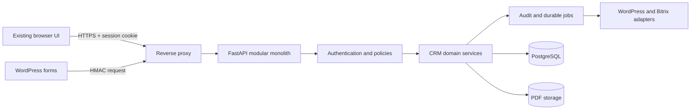

# Smart CRM MVP Productive Design

**Spec**: `.specs/features/crm-mvp/spec.md`  
**Status**: Approved  
**Approved by**: User continuation after the modular-monolith launch impact review  
**Date**: 2026-08-31

## Architecture Overview

The productive CRM evolves the existing FastAPI application into a modular monolith. The current HTML, normalized PostgreSQL schema, Alembic migrations, transaction boundary, and validated business flows remain the foundation. Productive modules replace whole-workspace reads and writes incrementally; they do not rebuild the interface.

| Slice | Product outcome | Requirements |
| --- | --- | --- |
| 1. Identity and security | Real login, revocable sessions, server authorization, secure configuration | AUTH-01..08 |
| 2. Granular core API | Authorized CRUD, pagination, concurrency, audit, performance | CORE-01..10 |
| 3. Commercial domain | Server-enforced Leads, Deals, pipelines, quotes, notifications, automations | LEAD-01..08, PIPE-01..07, QUOTE-01..05, NOTIF-01..04 |
| 4. WordPress | Authenticated, idempotent Lead capture and durable failures | FORM-01..06 |
| 5. Bitrix24 | Re-runnable inventory, migration, reconciliation, files, exceptions | MIG-01..07 |
| 6. Launch operations | Production overlay, backup/restore, observability, UAT, cutover, rollback | Success criteria |

Each slice remains deployable to private staging. Only Slice 6 supports a production launch decision.

## Security Model

- Login uses normalized e-mail and password at `POST /api/v1/auth/login`.
- Passwords use Argon2id through `pwdlib[argon2]`; plaintext is never logged or persisted.
- Login creates an opaque 256-bit token; PostgreSQL stores only its SHA-256 digest.
- Production sends `__Host-smartcrm_session` with `HttpOnly`, `Secure`, `SameSite=Lax`, and `Path=/`.
- Production fails fast without secure-cookie and trusted-origin settings. Explicit test mode uses a separate local cookie.
- Sessions default to 30 minutes idle and 12 hours absolute. Logout, password reset, and user deactivation revoke sessions.
- Invalid login is generic and unknown accounts receive a dummy Argon2 verification.
- Mutations require a session-bound synchronizer token in `X-CSRF-Token` plus Origin/Fetch Metadata checks.

Repositories receive an `AccessScope` and apply it in SQL. Loading an unauthorized row and filtering later is forbidden.

| Actor | Lead and Deal scope | Contact and Company scope | Administration |
| --- | --- | --- | --- |
| Administrator | Entire workspace | Entire workspace | Full MVP administration |
| Manager | Team-owned or explicit-assistant records | Team-owned; linked records readable | Team redistribution |
| Seller | Responsible or assistant | Owned; linked records readable | None |
| Assistant | Explicit assistant membership | Linked records read-only | None |
| Billing user | Seller policy; Billing team assignment | Linked records readable | None |

The existing `Faturamento` value remains import-compatible but has Seller-level authorization. Assignment uses active Billing team membership.

WordPress uses an integration credential, timestamp, submission identifier, and HMAC-SHA256 signature over timestamp and raw body. Invalid credentials are rejected before domain processing.

Security references:

- FastAPI Argon2 and dummy verification: <https://fastapi.tiangolo.com/tutorial/security/oauth2-jwt/>.
- OWASP password storage: <https://cheatsheetseries.owasp.org/cheatsheets/Password_Storage_Cheat_Sheet.html>.
- OWASP session cookies: <https://cheatsheetseries.owasp.org/cheatsheets/Session_Management_Cheat_Sheet.html>.
- OWASP CSRF prevention: <https://cheatsheetseries.owasp.org/cheatsheets/Cross-Site_Request_Forgery_Prevention_Cheat_Sheet.html>.

## Code Reuse Analysis

| Component | Location | Reuse |
| --- | --- | --- |
| FastAPI factory/errors/headers/health/static | `app/main.py` | Retain composition; extract routers and dependencies. |
| Transaction boundary | `app/database.py` | Domain changes and audit share `session_scope()`. |
| Normalized tables/indexes | `app/models.py` | Extend through Alembic. |
| Workspace reconciliation | `app/repositories/workspace.py` | Controlled bootstrap only during granular migration. |
| Workspace contracts | `app/schemas.py` | Reuse names/rules in per-module contracts. |
| Browser flows and layout | `app/static/index.html` | Replace persistence/profile simulation incrementally. |
| PostgreSQL test pattern | `tests/backend/test_repository.py` | Real migrations and isolated schemas. |
| HTTP contract pattern | `tests/backend/test_api.py` | Factory, fakes, errors, headers. |
| Container baseline | `Dockerfile`, `compose.yaml` | Non-root, read-only, health, local workflow. |

## Components and Interfaces

### Configuration — `app/config.py`

Validates database, cookie, origin, storage, integration, and production settings at startup through `Settings.from_env()` and `validate_runtime()`.

### Authentication — `app/auth/`

Owns credentials, login, current session, logout, revocation, and admin password setup. Exposes `/api/v1/auth/login`, `/session`, and `/logout`.

### Authorization — `app/auth/policies.py`

Produces reusable SQL scopes and mutation decisions from user, team, owner, responsible, and assistant relations. Direct lookup, search, counts, deleted records, files, and writes all reuse these predicates.

### Granular API — `app/api/routers/`

Exposes versioned Users, Leads, Contacts, Companies, Deals, Quotes, Notifications, custom fields, files, audit, and administration. Lists accept `limit <= 100`, opaque keyset cursor, search, sort, and filters. Mutable records expose integer `version`; stale writes return `409 version_conflict`.

### Domain services — `app/services/`

Enforce validation, links, soft deletion, Lead conversion, pipeline transitions, quote totals, notifications, and automations within one transaction.

### Audit, automations, jobs — `app/audit/`, `app/automations/`, `app/jobs/`

Append field-level evidence, execute rules with unique execution keys, and persist retryable jobs in PostgreSQL. `python -m app.worker` processes jobs with row locking; no external broker is required for the MVP.

### WordPress — `app/integrations/wordpress/`

Exposes `POST /api/integrations/wordpress/v1/submissions` plus admin retry. Preserves the submission before asynchronous/domain processing and returns the original Lead for a repeated external identifier.

### Bitrix24 — `app/migrations/bitrix24/`

Source adapters for export files and Cloud API emit canonical records. Services inventory, import, reconcile, and report counts/exceptions. Existing `bitrix_id`, external fields, and custom fields are reused.

### File storage — `app/files/`

`FileStore.put/open/delete` stores PDF bytes outside PostgreSQL. Only valid PDF content up to 20 MB is accepted; keys are random and downloads pass through Deal authorization.

### Browser adapter — `app/static/index.html`

A common request helper manages session, CSRF, structured errors, and 401 redirects. Per-module adapters replace whole-workspace persistence while reusing current rendering and dialogs.

## Data Models

| Model | Purpose / key constraint |
| --- | --- |
| `UserCredential` | One-to-one password hash and lock metadata for `CrmUser`. |
| `UserSession` | Unique token digest, CSRF digest, expiry, revocation, client metadata. |
| `IntegrationCredential` | Independent active/rotatable integration key. |
| `AuditEvent` | Append-only actor/request/entity/action/field changes. |
| `AutomationExecution` | Unique execution key for PIPE-07. |
| `QuoteAttachment` | Quote, random storage key, name, type, size, SHA-256. |
| `WordPressSubmission` | Unique credential/external id, payload, status, Lead, error. |
| `DurableJob` | Kind, payload, idempotency, status, attempts, availability, lock, error. |
| `MigrationRun` | Source manifest, status, timestamps, counters. |
| `MigrationItem` | Source/target identity, outcome, hash, error. |
| `MigrationException` | Entity, source id, field, reason, details. |

Mutable business entities gain a nonnegative `version`. Workspace `version` remains compatibility-only.

## API and Transaction Rules

1. Routers validate syntax; services validate business behavior; repositories scope SQL.
2. A mutation checks version, changes domain state, records notification/audit, and commits once.
3. External I/O is a durable job committed with domain state, never executed in that transaction.
4. Errors retain `{ "error": { "code", "message", ... } }`.
5. Out-of-scope records return `404`; role-forbidden admin operations return `403`.
6. Compatibility workspace endpoints are production-disabled and admin-only when explicitly enabled.
7. PostgreSQL stores UTC; the UI formats the configured business timezone.

## Error Handling Strategy

| Scenario | Handling | User impact |
| --- | --- | --- |
| Invalid/inactive login | Generic 401, dummy hash, failure counter | Generic invalid-credentials message. |
| Expired/revoked session | 401, clear cookie | Return to login. |
| Invalid CSRF | 403 before service | Reload/login guidance. |
| Entity outside scope | Scoped query finds nothing | 404 without disclosure. |
| Stale version | Rollback, stable 409 | Reload before retry. |
| Invalid domain input | Stable 422 with path | Existing form identifies failure. |
| Duplicate WordPress id | Return original outcome | No duplicate Lead. |
| Durable external failure | Persist retryable error | Admin can reprocess. |
| Invalid/large PDF | Reject before storage | Quote unchanged. |
| Database unavailable | Existing 503/log correlation | Temporary-unavailable state. |

## Deployment and Operations

- Local development keeps `compose.yaml`.
- Production removes database host publishing, requires non-default secrets, mounts PDF storage, and uses HTTPS.
- Alembic migration is an explicit release step before application replacement.
- Release requires database/PDF backup, restore rehearsal, structured logs, readiness, disk/database monitoring, and retention.
- Staging uses the production image/migration path with representative data.
- Cutover freezes Bitrix writes, completes final migration/reconciliation, receives UAT sign-off, switches WordPress, and keeps a rollback window.

## Risks & Concerns

| Concern | Location | Impact | Mitigation |
| --- | --- | --- | --- |
| Anonymous workspace API | `app/main.py:176` | Read/replace CRM data. | Authenticate first; production-disable compatibility. |
| Browser-simulated identity | `app/static/index.html:371`, `app/static/index.html:1000` | Identity switch/bypass. | Session identity and SQL scope. |
| Whole-workspace I/O | `app/static/index.html:885`, `app/static/index.html:901` | Payload, contention, exposure. | Granular module migration. |
| Broad reconciliation | `app/repositories/workspace.py:79` | Unrelated rewrites/locks. | Bootstrap-only. |
| Coupled HTTP module | `app/main.py:46` | Growing test/change cost. | Extract routers/dependencies. |
| Inline CSP | `app/main.py:238`, `app/static/index.html:1` | Larger XSS blast radius. | Extract assets; nonce/hash transition; remove `unsafe-inline`. |
| PDF name without bytes | `app/models.py:221` | No integrity/access control. | Attachments plus storage adapter. |
| No durable worker | `pyproject.toml:9` | Lost/duplicate integration work. | PostgreSQL jobs/execution keys. |
| `Faturamento` AUTH ambiguity | `app/static/index.html:506` | Privilege drift. | Seller policy plus Billing team tests. |
| External environment unknown | Server/WordPress/Bitrix inputs | Slices 4–6 lack real evidence. | Collect before their UAT/deployment. |

## Tech Decisions

| Decision | Choice | Rationale |
| --- | --- | --- |
| Shape | Modular FastAPI monolith | Reuse without distributed overhead. |
| Session | Opaque revocable PostgreSQL cookie | No browser token store; immediate revocation. |
| Password | Argon2id via `pwdlib` | Current FastAPI/OWASP guidance. |
| Authorization | SQL scopes plus mutation checks | Covers every access path. |
| Jobs | PostgreSQL durable jobs | Retry/idempotency without another broker. |
| API migration | Strangler by module | Preserve layout and reversibility. |
| Pagination | Opaque keyset, max 100 | Stable growing-volume performance. |
| Files | Adapter, persistent volume first | Single-server launch, S3 path retained. |
| External effects | Transactional durable job | Atomic state and safe retry. |

## Requirement Coverage

| Requirements | Designed components |
| --- | --- |
| AUTH-01..08 | Authentication, sessions, policies, users, browser adapter |
| CORE-01..10 | Routers, scoped repositories, versions, audit, transactions |
| LEAD-01..08 | Lead service, policy, audit, notifications, conversion |
| PIPE-01..07 | Deal service, automation, idempotency, audit |
| QUOTE-01..05 | Quote service, attachments, storage, Deal policy |
| FORM-01..06 | HMAC, submissions, jobs, Lead service |
| NOTIF-01..04 | Notification service and scoped API |
| MIG-01..07 | Source adapters, run/items/exceptions, reconciliation |

Design alone satisfies no acceptance criterion. Tasks and independent verification provide implementation evidence.
