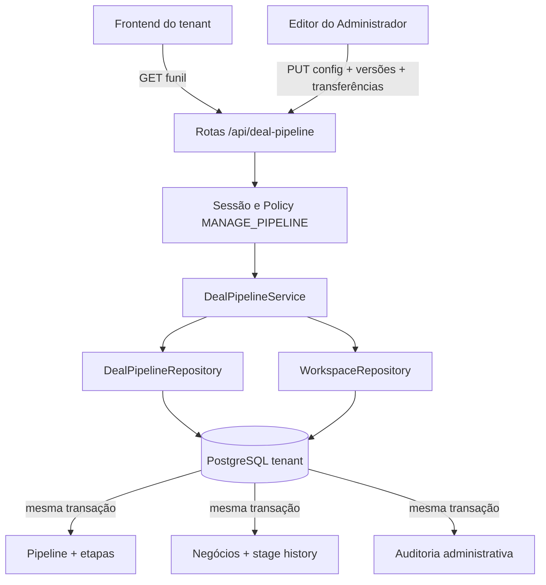

# Funil de Negócios Personalizável V1 — Design

**Spec**: `.specs/features/customizable-deal-pipeline/spec.md`  
**Status**: Approved

---

## Abordagem aprovada

Foram consideradas três abordagens que entregam o mesmo escopo:

| Abordagem | Vantagens | Problemas | Decisão |
| --------- | --------- | --------- | ------- |
| Entidades relacionais com IDs estáveis, API dedicada e auditoria | Integridade por FK, renomeação segura, transação atômica, preparada para múltiplos funis | Exige migração e integração cuidadosa com o snapshot atual | **Recomendada e aprovada** |
| Continuar usando o nome como identidade e reescrever todos os registros ao renomear | Menos tabelas novas | Rename frágil, histórico ambíguo, automações e concorrência dependem de texto | Rejeitada |
| Guardar configuração em JSON dentro do workspace | Implementação inicial curta | Navegador substituiria configuração administrativa; auditoria, FK e transferência atômica ficam fracas | Rejeitada |

## Architecture Overview

O funil será um agregado relacional dentro de cada banco tenant. Uma API dedicada fornecerá o read model a todos os usuários autenticados e aceitará substituição versionada da configuração somente de Administradores. O serviço calcula o diff, valida invariantes e, quando necessário, transfere Negócios e grava auditoria na mesma transação.



### Fluxo de leitura

1. O resolvedor de sessão seleciona o banco tenant e define `smartcrm.workspace_id`.
2. `GET /api/deal-pipeline` retorna a versão, etapa inicial e etapas ativas ordenadas.
3. Para Administrador, `include_archived=true` inclui arquivadas; nenhum outro perfil recebe esse detalhe.
4. O frontend usa IDs para estado e tipos semânticos para regras; nomes servem somente para exibição.

### Fluxo de gravação

1. `PUT /api/deal-pipeline` recebe `pipelineVersion`, `workspaceVersion`, lista desejada de etapas e mapa de transferências para etapas arquivadas.
2. O serviço bloqueia `Workspace` e `DealPipeline` com `FOR UPDATE` e compara versões.
3. O serviço normaliza nomes/cores/posições, calcula o diff e valida todos os invariantes antes de escrever.
4. Para cada arquivamento ocupado, o serviço transfere Negócios ativos e excluídos, atualiza os campos legados e acrescenta histórico de etapa.
5. O serviço grava um evento de auditoria com antes/depois e resumo, incrementa a versão do funil e, se Negócios mudaram, a versão do workspace.
6. Commit único publica todos os efeitos; qualquer erro reverte tudo.

---

## Code Reuse Analysis

### Existing Components to Leverage

| Component | Location | How to Use |
| --------- | -------- | ---------- |
| Tenant session resolver | `app/auth.py` | Derivar tenant, workspace, usuário e sessão PostgreSQL sem confiar no cliente. |
| Action policy | `app/policies.py` | Adicionar `MANAGE_PIPELINE` ao conjunto exclusivo de Administrador. |
| API factory and stable errors | `app/main.py` | Registrar as três rotas sob a mesma autenticação/origin policy. |
| Workspace optimistic version | `app/services/workspace.py` | Integrar a versão do workspace para invalidar snapshots após transferência. |
| Workspace repository | `app/repositories/workspace.py` | Manter payload legado e histórico de movimentação coerentes. |
| Tenant RLS pattern | `migrations/versions/a4c9d2e7f1b6_secure_multitenancy_tenant_database.py` | Aplicar `workspace_id`, RLS habilitada/forçada e política `USING/WITH CHECK` às novas tabelas. |
| Fleet preflight/migration | `app/fleet.py` | Evoluir a revisão esperada por tenant selecionado sem expor migração web. |
| Admin layout and dialogs | `app/static/index.html` | Reusar navegação, cards, modal, feedback e responsividade existentes. |
| Backend and browser harness | `tests/backend`, `tests/ui-prototype.spec.cjs` | Manter padrões de pytest/PostgreSQL e Playwright usados pelo projeto. |

### Integration Points

| System | Integration Method |
| ------ | ------------------ |
| Workspace snapshot | Negócios passam a carregar `pipelineId` e `stageId`; `stage` textual permanece como campo de compatibilidade desta versão. |
| Dashboard/Kanban/filter | Usam o read model do funil, `semanticType`, `systemKey` e ordem; não consultam constantes de nomes. |
| Stage history | Adiciona IDs de origem/destino e mantém os nomes como snapshots históricos. |
| Control plane | `expected_tenant_revision` é atualizado somente pelo fluxo operacional explícito de tenant selecionado. |
| Windows package | O pacote offline inclui a nova migração e runbook de preflight/cutover; não altera HBA, listener ou bancos DW. |

---

## Components

### Deal pipeline models

- **Purpose**: Representar pipeline, etapas e auditoria com IDs estáveis e escopo de workspace.
- **Location**: `app/models.py`
- **Interfaces**: entidades SQLAlchemy `DealPipeline`, `DealPipelineStage`, `DealPipelineAuditEvent`; novas FKs em `Deal` e `DealStageHistory`.
- **Dependencies**: SQLAlchemy 2, PostgreSQL UUID/JSONB.
- **Reuses**: `Base`, `TimestampMixin`, convenções de índice/FK existentes.

### Pipeline schemas

- **Purpose**: Validar read model, configuração desejada, versões e transferências.
- **Location**: `app/schemas.py`
- **Interfaces**:
  - `DealPipelineResponse`
  - `DealPipelineUpdateRequest`
  - `DealPipelineAuditPage`
- **Dependencies**: Pydantic strict models.
- **Reuses**: aliases camelCase e validação estrita já usados no workspace.

### DealPipelineRepository

- **Purpose**: Ler/bloquear o agregado e executar queries escopadas por workspace.
- **Location**: `app/repositories/pipeline.py`
- **Interfaces**:
  - `load_default(include_archived: bool) -> DealPipelineAggregate`
  - `lock_default() -> DealPipeline`
  - `count_deals_by_stage(stage_ids) -> Mapping[UUID, int]`
  - `transfer_deals(source_id, target, actor, at) -> int`
  - `append_audit(event) -> DealPipelineAuditEvent`
- **Dependencies**: sessão tenant com contexto RLS ativo.
- **Reuses**: padrões de escopo e payload de `WorkspaceRepository`.

### DealPipelineService

- **Purpose**: Validar invariantes, calcular diff, aplicar configuração e coordenar transação/versões.
- **Location**: `app/services/pipeline.py`
- **Interfaces**:
  - `load(session, principal, include_archived=False)`
  - `update(session, principal, request)`
  - `history(session, principal, before_id=None, limit=50)`
- **Dependencies**: pipeline repository, workspace repository, policy principal.
- **Reuses**: erros de conflito e semântica de versão de `WorkspaceService`.

### Pipeline API

- **Purpose**: Expor leitura, atualização e auditoria com respostas estáveis.
- **Location**: `app/main.py`
- **Interfaces**:
  - `GET /api/deal-pipeline`
  - `PUT /api/deal-pipeline`
  - `GET /api/deal-pipeline/history?before=<id>&limit=50`
- **Dependencies**: `resolve_principal`, `require_action`, expected-origin para PUT.
- **Reuses**: cabeçalhos `no-store` e tratamento de erros da aplicação central.

### Workspace stage canonicalizer

- **Purpose**: Impedir que snapshots genéricos inventem/reativem etapas e sincronizar IDs/texto legado.
- **Location**: `app/services/workspace.py`
- **Interfaces**: `canonicalize_deal_stages(session, submitted_state, canonical_state)` antes do reconcile.
- **Dependencies**: pipeline repository.
- **Reuses**: merge autorizado e versão otimista do workspace.

### Frontend pipeline registry

- **Purpose**: Substituir `dealStages` e heurísticas por nome por um registry carregado do servidor.
- **Location**: `app/static/index.html`
- **Interfaces**: helpers `stageById`, `activeDealStages`, `isWon`, `isLost`, `isBilling`, `initialStage`.
- **Dependencies**: `GET /api/deal-pipeline` e estado do workspace.
- **Reuses**: renderizadores de lista, Kanban, filtros e dashboard existentes.

### Admin pipeline editor

- **Purpose**: Editar etapas, confirmar transferências e consultar auditoria.
- **Location**: `app/static/index.html`
- **Interfaces**: página Funil de negócios, linha de etapa, reordenação acessível, modal de arquivamento, histórico paginado.
- **Dependencies**: Pipeline API.
- **Reuses**: navegação admin, modal, toast, formulários e estilos atuais.

### Fleet revision advancement

- **Purpose**: Migrar tenant selecionado para o head e avançar sua revisão esperada somente após verificação.
- **Location**: `app/fleet.py`
- **Interfaces**: migração recebe `target_revision`; verifica identidade/head e atualiza controle em transação separada somente após sucesso.
- **Dependencies**: control database e Alembic.
- **Reuses**: seleção explícita, backup acknowledgement e confirmação existentes.

---

## Data Models

### DealPipeline

| Field | Type | Constraint |
| ----- | ---- | ---------- |
| `id` | UUID | PK |
| `workspace_id` | varchar(64) | FK workspaces, RLS, not null |
| `name` | varchar(80) | not null |
| `version` | integer | `>= 1`, not null |
| `is_default` | boolean | one default per workspace by partial unique index |
| `default_stage_id` | UUID | FK stage, active/open enforced by service |
| timestamps | timestamptz | not null |

### DealPipelineStage

| Field | Type | Constraint |
| ----- | ---- | ---------- |
| `id` | UUID | PK, immutable |
| `workspace_id` | varchar(64) | FK workspaces, RLS, not null |
| `pipeline_id` | UUID | FK deal_pipelines, not null |
| `name` | varchar(80) | trimmed; active uniqueness by `lower(name)` |
| `semantic_type` | varchar(16) | check in `open`, `won`, `lost`; immutable |
| `color` | varchar(7) | check `^#[0-9A-Fa-f]{6}$` |
| `position` | integer | nonnegative; active positions normalized |
| `system_key` | varchar(32), nullable | immutable; `billing` unique when present |
| `archived_at` | timestamptz, nullable | null means active |
| timestamps | timestamptz | not null |

Composite uniqueness `(workspace_id, pipeline_id, id)` supports tenant-safe FKs. Partial indexes enforce unique active normalized name and position.

### DealPipelineAuditEvent

| Field | Type | Constraint |
| ----- | ---- | ---------- |
| `id` | bigint | PK, monotonic cursor |
| `workspace_id` | varchar(64) | FK workspaces, RLS, not null |
| `pipeline_id` | UUID | FK pipeline, not null |
| `actor_user_id` | varchar(128) | FK crm_users, not null |
| `pipeline_version` | integer | resulting version |
| `action` | varchar(64) | `pipeline.updated` |
| `actions` | JSONB | normalized action summaries |
| `before_state` | JSONB | configuration only |
| `after_state` | JSONB | configuration only |
| `transfer_summary` | JSONB | source, destination and count; no deal payloads |
| `created_at` | timestamptz | server time, not null |

### Deal additions

- `pipeline_id UUID NOT NULL`
- `stage_id UUID NOT NULL`
- Composite FK `(workspace_id, pipeline_id, stage_id)` to the stage table with `ON DELETE RESTRICT`.
- `stage varchar(128)` remains synchronized as a compatibility display value for this release.

### DealStageHistory additions

- `from_stage_id UUID NULL`
- `to_stage_id UUID NOT NULL`
- Existing `from_stage` and `to_stage` remain immutable display snapshots.
- IDs refer to archived stages because stages are never physically deleted.

---

## API Contracts

### GET `/api/deal-pipeline`

Returns `pipelineVersion`, `workspaceVersion`, pipeline metadata, initial stage ID and ordered active stages. `include_archived=true` is accepted only for Administrador.

### PUT `/api/deal-pipeline`

```json
{
  "pipelineVersion": 3,
  "workspaceVersion": 14,
  "defaultStageId": "uuid",
  "stages": [
    {
      "id": "uuid-or-null-for-create",
      "name": "Em análise",
      "semanticType": "open",
      "color": "#4F46E5",
      "position": 0,
      "archived": false
    }
  ],
  "transfers": {
    "archived-source-uuid": "active-target-uuid"
  }
}
```

Success returns the canonical pipeline, resulting versions and transfer counts. Validation returns 422 with stable field codes; stale versions return 409 `pipeline_version_conflict`; non-admin returns 403.

### GET `/api/deal-pipeline/history`

Returns up to 50 events, newest first, with `nextBefore` cursor. Endpoint is admin-only and `Cache-Control: no-store` remains in effect.

---

## Migration Strategy

1. Preflight asserts the current revision and exactly the approved legacy stage names used by `deals.stage` and history snapshots that require IDs.
2. Create pipeline, stage and audit tables with workspace FKs and constraints.
3. Seed one default pipeline and the nine stages for every existing workspace using deterministic UUIDs derived from stable constants, preserving UI order/colors.
4. Add nullable `pipeline_id`/`stage_id` columns to deals and ID columns to history.
5. Backfill by exact legacy name and abort if any required target is unresolved.
6. Validate row counts, non-null backfill and relationship counts before applying NOT NULL/FKs/indexes.
7. Enable and force RLS on all new tenant tables with both `USING` and `WITH CHECK`.
8. Keep legacy text columns and payload fields synchronized for rollback compatibility.
9. Publish the new tenant head only after all checks pass.

The migration is additive. A rollback of the application can still read the synchronized text fields. A database downgrade is supported only in an isolated tested environment and must not be used as the production rollback mechanism.

---

## Error Handling Strategy

| Error Scenario | Handling | User Impact |
| -------------- | -------- | ----------- |
| Non-admin mutation/history | 403 before service writes | Mensagem de acesso negado; nenhuma mudança. |
| Invalid name/color/type/order/default | 422 with stable code | Editor highlights the invalid field. |
| Missing/invalid archive target | 422 before writes | Modal remains open with guidance. |
| Stale pipeline/workspace version | 409 `pipeline_version_conflict` | Editor asks to reload current configuration. |
| Archived/foreign stage in workspace save | 409 `stage_configuration_changed` | Operation is stopped and current state is reloaded. |
| PostgreSQL or audit failure | Transaction rollback; 503/500 stable response | No partial transfer or archive. |
| Unknown legacy stage | Alembic migration abort | Cutover does not publish the incompatible head. |
| Tenant route mismatch | Existing auth failure path | No cross-tenant configuration is returned. |

---

## Risks & Concerns

| Concern | Location (file:line) | Impact | Mitigation |
| ------- | -------------------- | ------ | ---------- |
| Names currently drive semantic behavior | `app/static/index.html:590`, `app/static/index.html:1545`, `app/static/index.html:2253` | Rename can break dashboard, gain state and billing automation | Replace every branch with stage ID/type/system key and add browser regressions after rename. |
| Whole-snapshot save can overwrite bulk transfer | `app/services/workspace.py`, `app/repositories/workspace.py:373` | Stale tab may restore old stages/deals | Transfer bumps workspace version; generic saves canonicalize stage IDs and reject archived/stale references. |
| Deal payload duplicates relational columns | `app/repositories/workspace.py:386` | Name/ID can drift | Repository writes canonical ID/name to both relational fields and packed record; tests compare both. |
| History is deleted/recreated by reconcile | `app/repositories/workspace.py:414` | Dedicated transfer history could be lost by later save | Canonicalization merges server history by immutable event identity instead of trusting browser replacement. |
| Tenant revision advancement is not supported by current fleet verifier | `app/fleet.py:172` | Migration to a new head verifies against the old expected revision | Extend fleet flow with explicit target revision and control update only after database verification. |
| New tenant tables could miss RLS | `migrations/versions/a4c9d2e7f1b6_secure_multitenancy_tenant_database.py:136` | Cross-workspace access within a tenant DB | Migration security tests enumerate metadata and policies, including negative missing-context tests. |
| Frontend is a large single HTML file | `app/static/index.html` | Broad edit and regression risk | Introduce a small pipeline registry section and make changes in separate tested tasks; avoid unrelated refactor. |
| Current tests assert exactly nine stage names | `tests/ui-prototype.spec.cjs:1682` | Existing tests fail or mask dynamic behavior | Replace those assertions with seeded-default plus customization scenarios; never weaken unrelated assertions. |
| README deployment status is stale | `README.md:5` | Operators may follow obsolete assumptions | Documentation task updates status and revision instructions without performing deploy. |

---

## Tech Decisions

| Decision | Choice | Rationale |
| -------- | ------ | --------- |
| Identity | UUID stage IDs; names are display snapshots | Enables safe rename and durable links. |
| Mutation API | Versioned whole-aggregate PUT | Supports atomic validation/diff/transfer while keeping endpoints small. |
| Configuration storage | Dedicated tenant tables | Enforces FK, RLS, audit and future multi-pipeline support. |
| History | Append-only via API, one event per successful aggregate save | Captures a coherent before/after transaction. |
| Backward compatibility | Keep and synchronize legacy stage text for one release | Makes application rollback practical after additive migration. |
| Automation | Immutable `system_key` separate from name | Faturamento survives rename without exposing automation editor. |
| Concurrency | Pipeline version plus workspace version on deal transfer | Protects config and the existing snapshot protocol. |
| Multi-pipeline future | Persist pipeline IDs now, expose exactly one default | Avoids another identity migration without ampliar a V1. |

This feature establishes a project-level convention: mutable business labels must not serve as persistent identity or semantic state. It is recorded as AD-008 in `.specs/STATE.md`.
