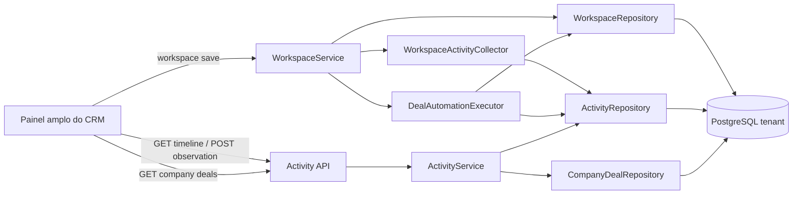

# Histórico Operacional de Negócios e Empresas V1 — Design

**Spec**: `.specs/features/deal-company-activity-history/spec.md`  
**Status**: Approved

---

## Architecture Overview

O histórico será um fluxo append-only persistido no banco tenant. Ele não fará parte do snapshot substituível de `/api/workspace`. Toda movimentação, automação e alteração cadastral produzirá um evento no servidor, na mesma transação PostgreSQL da mutação comercial. Observações usarão endpoints dedicados e idempotentes.

Uma tabela `crm_activity_events` atenderá Negócios e Empresas. Duas FKs opcionais e uma restrição `CHECK` garantem exatamente um assunto por evento. A leitura usa paginação keyset por `(occurred_at, id)` e aplica as mesmas regras de visibilidade do registro.

A automação de Faturamento sairá do navegador e passará a ser executada no servidor. A interface continuará otimista apenas para a movimentação visual; responsável, notificação e evento virão do estado canônico devolvido pela API.



### Approaches considered

| Approach | Verdict | Reason |
| -------- | ------- | ------ |
| Dedicated append-only server history | Chosen | Delivers atomicity, immutable audit, cursor pagination and tenant isolation. |
| Derive history at read time from stage history and notifications | Rejected | Notifications are mutable and no reliable company-change history exists. |
| Store activity arrays inside entity payloads | Rejected | The client could overwrite history and every save would resend an unbounded payload. |

---

## Code Reuse Analysis

### Existing Components to Leverage

| Component | Location | How to use |
| --------- | -------- | ---------- |
| Tenant session and transaction boundary | `app/auth.py:192`, `app/tenant_database.py:253` | Reuse the request-scoped tenant session; commit/rollback remains centralized. |
| Record authorization | `app/policies.py:80` | Reuse `can_read_record` and `can_mutate_record` after loading the canonical record scope. |
| Stage identity and semantics | `app/models.py:68`, `app/models.py:98` | Use immutable stage IDs and `open`/`won`/`lost` for events and company summaries. |
| Existing transition history | `app/models.py:361` | Backfill past movement events and preserve it as the compatibility/domain transition source. |
| Workspace canonicalization | `app/services/workspace.py:365`, `app/services/workspace.py:469` | Extract confirmed transitions and company diffs before reconciliation. |
| Pipeline bulk transfer | `app/repositories/pipeline.py:187` | Return structured transferred-deal results so the shared activity/automation writer can run atomically. |
| Audit cursor pattern | `app/repositories/pipeline.py:337` | Reuse bounded pages and descending keyset behavior, extended to timestamp plus ID. |
| API error envelope | `app/main.py:45` | Return the existing `{error:{code,message}}` contract and `no-store` headers. |
| Drawer behavior | `app/static/index.html:233`, `app/static/index.html:2476` | Extend the existing drawer, focus management and dirty-form guard rather than create a parallel modal system. |
| Browser persistence queue | `app/static/index.html:973` | Keep normal entity saves on the current queue; activity reads/observations use independent requests. |
| PostgreSQL RLS migration pattern | `migrations/versions/c7f3a9d8e2b1_add_customizable_deal_pipeline.py:316` | Apply the same enabled/forced workspace policy to the new event table. |

### Integration Points

| System | Integration method |
| ------ | ------------------ |
| Workspace save | Collect server-side transition/company events after authorization and canonicalization, then append after reconciliation in the same session. |
| Pipeline stage transfer | Return each transferred deal and append its movement event; execute the billing rule when the destination has `system_key=billing`. |
| Notification module | Server automation creates canonical notifications through the existing repository state, but timeline reads never derive from mutable notifications. |
| Deal drawer | Fetch activity after opening; cancel/ignore stale requests when another record opens. |
| Company drawer | Fetch summary/list and history only when the respective tab is selected. |
| Fleet migration | Add one tenant Alembic revision and advance only explicitly selected/verified tenants through the existing fleet process. |

---

## Components

### `CrmActivityEvent` model and migration

- **Purpose**: Persist one immutable, tenant-scoped event for exactly one Deal or Company.
- **Location**: `app/models.py`, `migrations/versions/<revision>_add_crm_activity_events.py`
- **Interfaces**: SQLAlchemy model only; writes are restricted to `ActivityRepository`.
- **Dependencies**: `Workspace`, `Deal`, `Company`, `CrmUser`, PostgreSQL JSONB and RLS.
- **Reuses**: Naming convention, `workspace_id` policy and BigInteger audit IDs.

### `ActivityRepository`

- **Purpose**: Validate workspace context, append deduplicated events and page one entity timeline.
- **Location**: `app/repositories/activity.py`
- **Interfaces**:
  - `append(event: NewActivityEvent) -> CrmActivityEvent`
  - `append_many(events: Sequence[NewActivityEvent]) -> tuple[CrmActivityEvent, ...]`
  - `list_for_deal(deal_id, category, cursor, limit) -> ActivityPageRows`
  - `list_for_company(company_id, category, cursor, limit) -> ActivityPageRows`
  - `find_by_dedupe_key(key) -> CrmActivityEvent | None`
- **Dependencies**: Request-scoped `Session`, RLS context and canonical entities.
- **Reuses**: Scope guard from `DealPipelineRepository` and bounded history query pattern.

The repository never accepts tenant/workspace/actor/timestamp from HTTP payloads. It receives those values from `PrincipalScope` and the service clock.

### `ActivityService`

- **Purpose**: Enforce record visibility, validate observations, encode/decode cursors and map events to API responses.
- **Location**: `app/services/activity.py`
- **Interfaces**:
  - `deal_timeline(session, principal, deal_id, query) -> ActivityPage`
  - `company_timeline(session, principal, company_id, query) -> ActivityPage`
  - `add_deal_observation(session, principal, deal_id, request) -> ActivityEventResponse`
  - `add_company_observation(session, principal, company_id, request) -> ActivityEventResponse`
- **Dependencies**: `ActivityRepository`, policy helpers, canonical record scope and server clock.
- **Reuses**: `PrincipalScope`, `RecordScope`, `can_read_record`, `can_mutate_record`.

The service returns 404 for nonexistent, cross-workspace and invisible records. This avoids resource enumeration. It returns 403 only when the record is visible but the action is not permitted.

### `WorkspaceActivityCollector`

- **Purpose**: Compare the canonical authorized state with the next canonical state and produce typed activity drafts.
- **Location**: `app/services/activity.py`
- **Interfaces**:
  - `collect_company_changes(before, after, principal, operation_key) -> tuple[NewActivityEvent, ...]`
  - `collect_deal_transitions(before, after, stage_registry, principal, operation_key) -> tuple[DealTransition, ...]`
- **Dependencies**: Canonical workspace snapshots and immutable stage registry.
- **Reuses**: The before/after snapshots already loaded by `WorkspaceService.save`.

Company diffs cover `name`, `ownerId`, `city`, `segment`, `phone` and custom-field values. They ignore UI-only metadata, ordering, `updatedAt`, visible-field preferences and unchanged values. One workspace save produces at most one `company.updated` event per changed company.

### `DealAutomationExecutor`

- **Purpose**: Execute server-owned stage automations and emit one safe result event per execution.
- **Location**: `app/services/deal_automation.py`
- **Interfaces**:
  - `execute_for_transition(session, principal, transition, operation_key) -> AutomationResult | None`
- **Dependencies**: Stage `system_key`, canonical users, notifications and `ActivityRepository`.
- **Reuses**: Existing Faturamento rule and notification presentation.

For `system_key=billing`, the executor finds the active canonical Faturamento assignee defined by the existing seeded identity/rule. On success it changes responsible/team, creates the existing user notification and appends `deal.automation_executed` with `result=success`. If the target is unavailable, the stage transition remains confirmed, the responsible remains unchanged and the executor appends `result=failure` with a safe business reason. Database exceptions still roll back transition and event together.

The same executor is called by ordinary workspace transitions and administrative bulk transfers. A deterministic execution key prevents duplicate notification/effect/event on retry.

### `CompanyDealRepository` and service

- **Purpose**: Return lossless counts, monetary totals and visible linked Deals from canonical tables.
- **Location**: `app/repositories/company_deals.py`, `app/services/company_deals.py`
- **Interfaces**:
  - `summary(session, principal, company_id) -> CompanyDealSummaryResponse`
- **Dependencies**: `Deal`, `DealPipelineStage`, `CrmUser`, `DealAssistant` and record policy.
- **Reuses**: Immutable stage semantic types and current deal visibility rules.

The SQL excludes `Deal.deleted_at IS NOT NULL`. It applies role scope before aggregation:

- Administrador: all visible tenant Deals;
- Gestor: Deals of the same team;
- Vendedor, Assistente and Faturamento: responsible or assistant membership.

Amounts remain `Decimal` through SQL/Pydantic and serialize as fixed two-decimal strings. The list and summary come from the same filtered relation so counts cannot disclose inaccessible Deals.

### Activity HTTP contracts

- **Purpose**: Expose explicit entity-oriented endpoints instead of extending the workspace snapshot.
- **Location**: `app/schemas.py`, `app/main.py`
- **Interfaces**:

| Method | Path | Result |
| ------ | ---- | ------ |
| GET | `/api/deals/{deal_id}/activities?category=&cursor=&limit=` | Deal activity page. |
| POST | `/api/deals/{deal_id}/observations` | Creates or returns one idempotent observation. |
| GET | `/api/companies/{company_id}/activities?category=&cursor=&limit=` | Company activity page. |
| POST | `/api/companies/{company_id}/observations` | Creates or returns one idempotent observation. |
| GET | `/api/companies/{company_id}/deals` | Counts, values and visible linked Deal rows. |

All endpoints use the cookie principal dependency. POST bodies contain only `text` and `idempotencyKey`. Mutation requests inherit the existing exact-Origin validation. Responses receive `Cache-Control: no-store`.

### Deal activity panel

- **Purpose**: Display and filter the timeline and publish observations beside existing Deal data.
- **Location**: `app/static/index.html`
- **Interfaces**:
  - `loadEntityActivities(entity, id, options)`
  - `renderActivityTimeline(state)`
  - `submitObservation(entity, id, text)`
  - `loadNextActivityPage()`
- **Dependencies**: Activity endpoints, current session identity and drawer lifecycle.
- **Reuses**: Existing escape helper, toast, API wrapper, focus trap/close behavior and user labels.

At desktop width, `.entity-drawer.deal-workspace` uses `width: min(1600px, calc(100vw - 32px))` and a two-column grid. The left column keeps Information, Additional Fields and Quotes. The right column contains observation composer, filters and timeline. Under the responsive breakpoint, Activity becomes a tab/stacked section. The exact breakpoint is CSS-driven and covered at representative desktop/mobile widths.

Each open request receives a local generation token or `AbortController`. A late response for a previously opened entity is discarded. Loading, empty, error and retry states affect only the activity column.

### Company profile panels

- **Purpose**: Add `Negócios` and `Histórico` to the Company drawer.
- **Location**: `app/static/index.html`
- **Interfaces**:
  - `loadCompanyDeals(companyId)`
  - `renderCompanyDealSummary(summary)`
  - shared activity functions for the History tab.
- **Dependencies**: Company endpoints and drawer tab state.
- **Reuses**: Existing stat cards, money formatter, table/list components and entity navigation.

The `Negócios` tab renders Total, In Progress, Won and Lost cards. Each status card contains count and amount. The list shows title, stage, status, responsible and value. Selecting a row opens the Deal drawer; closing it returns to the same Company and active tab in memory.

---

## Data Models

### `CrmActivityEvent`

```python
class CrmActivityEvent(Base):
    id: Mapped[int]                       # BIGINT identity
    workspace_id: Mapped[str]
    deal_id: Mapped[str | None]
    company_id: Mapped[str | None]
    category: Mapped[str]                 # movement|automation|observation|change
    event_type: Mapped[str]               # stable machine key
    actor_user_id: Mapped[str | None]
    actor_name: Mapped[str]                # display snapshot; "Sistema" allowed
    summary: Mapped[str]
    details: Mapped[dict[str, Any]]        # validated event-specific payload
    dedupe_key: Mapped[str]
    occurred_at: Mapped[datetime]
```

**Constraints and indexes**:

- exactly one of `deal_id` and `company_id` is non-null;
- `category IN ('movement','automation','observation','change')`;
- unique `(workspace_id, dedupe_key)`;
- partial index `(workspace_id, deal_id, occurred_at DESC, id DESC)` for Deal rows;
- partial index `(workspace_id, company_id, occurred_at DESC, id DESC)` for Company rows;
- FK to workspace and optional FKs to Deal, Company and actor;
- RLS enabled and forced with the standard workspace policy.

### Event detail contracts

```python
StageTransitionDetails = {
    "fromStageId": UUID | None,
    "fromStageName": str | None,
    "toStageId": UUID,
    "toStageName": str,
    "source": "user" | "pipeline_transfer",
}

AutomationDetails = {
    "automationKey": str,
    "automationName": str,
    "result": "success" | "failure",
    "actions": list[{"type": str, "summary": str}],
    "failureCode": str | None,
}

ObservationDetails = {"text": str}

CompanyChangeDetails = {
    "changes": list[{"field": str, "label": str, "before": JSON, "after": JSON}]
}
```

Only these whitelisted structures reach API responses. Internal exception text, credentials and arbitrary notification payloads never enter `details`.

### API contracts

```python
class ObservationCreateRequest:
    text: str                 # trimmed, 1..4000
    idempotency_key: UUID

class ActivityQuery:
    category: Literal["movement", "automation", "observation", "change"] | None
    cursor: str | None        # opaque base64url of occurred_at + id
    limit: int                # 1..50, default 50

class ActivityEventResponse:
    id: int
    category: str
    event_type: str
    actor: {"id": str | None, "name": str, "kind": "user" | "system"}
    summary: str
    details: dict
    occurred_at: datetime

class ActivityPage:
    items: list[ActivityEventResponse]
    next_cursor: str | None

class CompanyDealSummaryResponse:
    total_count: int
    open: {"count": int, "amount": Decimal}
    won: {"count": int, "amount": Decimal}
    lost: {"count": int, "amount": Decimal}
    items: list[CompanyDealRow]
```

### Cursor contract

The cursor contains only the last row's UTC timestamp and numeric ID, signed/validated as an opaque versioned payload. The next query applies:

```sql
WHERE (occurred_at, id) < (:occurred_at, :id)
ORDER BY occurred_at DESC, id DESC
LIMIT :limit_plus_one
```

Malformed, cross-version or out-of-bounds cursors return HTTP 422. Cursors never contain tenant or entity selectors.

---

## Transaction Workflows

### Normal Deal stage movement

1. `WorkspaceService.save` authenticates, locks workspace/pipeline and checks versions.
2. It loads canonical state and applies authorization merge.
3. Canonicalization emits a `DealTransition` instead of trusting submitted history.
4. The automation executor applies the server-owned billing effect when applicable.
5. `WorkspaceRepository.reconcile` writes the Deal, transition history and notifications.
6. `ActivityRepository` appends movement and optional automation events using deterministic dedupe keys.
7. Workspace version, commercial rows, notifications and activities commit together.

### Company update

1. The collector compares canonical and authorized next Company values.
2. It emits no event for a no-op.
3. Reconciliation writes the Company/custom fields.
4. One `company.updated` event containing only whitelisted changed fields is appended.
5. Both writes commit or roll back together.

### Manual observation

1. The activity service loads the canonical entity and its record scope.
2. It verifies mutation permission.
3. It validates trimmed text and server-derived metadata.
4. It inserts using `observation:{request_uuid}` as dedupe key.
5. A retry returns the existing event without changing the workspace version.

### Administrative bulk transfer

1. Pipeline service locks and validates the pipeline as today.
2. Repository transfers each Deal and returns structured transition results.
3. Shared automation executor runs for eligible targets.
4. Activity writer appends one movement and at most one automation event per Deal.
5. Pipeline audit, workspace version and all Deal events commit together.

---

## Migration and Compatibility

1. Create `crm_activity_events` additively after `c7f3a9d8e2b1`.
2. Enable/force RLS and create the standard workspace policy before application access.
3. Backfill every existing `deal_stage_history` row as `deal.stage_changed`, preserving `changed_at`, stage snapshots and actor when available. Dedupe key: `legacy-stage-history:{id}`.
4. Backfill one `company.created` event for each existing Company using `Company.created_at`, actor `Sistema (migração)` and dedupe key `legacy-company-created:{id}`. It does not claim a historical human actor.
5. Keep `deal_stage_history` and its compatibility fields unchanged. New stage movements dual-write it and the activity stream.
6. Old releases ignore the new table, so application rollback remains possible without schema downgrade.
7. Alembic downgrade drops only the new table/policy and is allowed only in disposable validation databases; it is not an operational rollback after new observations exist.
8. Extend tenant head/fleet verification, offline package manifest and PostgreSQL 11 migration tests. Do not touch control schema, shared DW databases, listener or HBA.

---

## Error Handling Strategy

| Error scenario | Handling | User impact |
| -------------- | -------- | ----------- |
| Entity missing, cross-tenant or invisible | Return generic 404 | No metadata leakage. |
| Visible but mutation forbidden | Return 403 and audit denial through existing middleware | Composer remains disabled/error is shown. |
| Empty/oversized observation | Return 422 with field path | Text remains available for correction. |
| Duplicate observation retry | Return existing event with 200 | No duplicate timeline item. |
| Invalid/expired cursor | Return 422 | Timeline offers reload from first page. |
| Timeline database failure | Existing SQLAlchemy handler returns 503 + error ID | Data form remains usable; activity column shows retry. |
| Billing target unavailable | Commit stage plus safe failure activity; do not reassign | Timeline explains automation failure without secrets. |
| Database failure during mutation/event | Roll back entire request | Existing state remains canonical. |
| Late browser response | Ignore by request generation/abort token | No activity from another record appears. |
| Company has no visible Deals | Return zeros and empty list | Normal empty state. |

---

## Security Design

- The HTTP client never supplies workspace, tenant, actor or occurrence time.
- Entity IDs are resolved only within the RLS-scoped tenant session.
- Deal reads and observations reuse record-level authorization, including assistant/team scope.
- Company summaries apply Deal visibility before aggregation to avoid leaking hidden values through totals.
- Observation text is plain text. Rendering always uses `escapeHTML`; no Markdown/HTML execution is allowed.
- Event details use discriminated server schemas and whitelist fields. No raw Python errors or arbitrary client payloads are stored.
- Events expose no update/delete route. Database application roles receive only the permissions already required through the service.
- Response caching is disabled for every activity/company-summary endpoint.

---

## Test Strategy

| Layer | Coverage |
| ----- | -------- |
| Model/schema | Constraints, indexes, typed details, bounds, fixed money serialization. |
| Migration | Upgrade/backfill/RLS/downgrade in isolated PostgreSQL 11-compatible database; existing fingerprints unchanged. |
| Repository | Scope guard, dedupe, category filter, timestamp+ID cursor, aggregation and access predicate. |
| Service | Read/mutate authorization, no-op diffs, redaction, billing success/failure, atomic rollback and retries. |
| API | Cookie session, exact Origin on POST, 404 non-disclosure, 403, 422, no-store and response contracts. |
| Tenant isolation | Two tenant databases/workspaces; forged IDs and missing RLS context fail closed. |
| Browser | Wide Deal layout, filters, paging, note submit/reload, Company cards/list/history, nested navigation, mobile and keyboard. |
| Regression | Existing workspace, pipeline, quotes, custom fields, notifications and undo semantics remain green. |

The browser test must assert that moving into Billing produces its responsible change, notification and one activity event only after the canonical save succeeds. A targeted mutant that disables server automation or company semantic grouping must fail.

---

## Risks & Concerns

| Concern | Location (file:line) | Impact | Mitigation |
| ------- | -------------------- | ------ | ---------- |
| Billing automation currently runs only in browser code | `app/static/index.html:2778` | API clients can bypass it and the timeline cannot prove execution. | Move rule to `DealAutomationExecutor`; remove client-owned reassignment/notification and assert canonical response. |
| Workspace save reconciles a large client snapshot | `app/services/workspace.py:365` | Putting events in the snapshot would allow overwrite and payload growth. | Keep activities behind dedicated append-only APIs/table and derive server events from before/after canonical state. |
| Stage history and activity become dual-written | `app/repositories/workspace.py:440`, `app/repositories/pipeline.py:187` | A missed hook can create drift. | One shared transition result/writer, deterministic dedupe keys and parity tests across normal/bulk paths. |
| Frontend is a large single HTML/JS file | `app/static/index.html:2476` | Drawer changes can regress unrelated forms and focus behavior. | Make localized entity-specific render/load functions; avoid unrelated refactor; add Playwright coverage for every existing tab. |
| Current drawer is only 560px | `app/static/index.html:233` | Timeline and form cannot coexist. | Add entity modifier class and responsive grid; keep default width for unaffected Lead/Contact panels. |
| Policy is Python record-based, not a reusable SQL predicate | `app/policies.py:80` | Company aggregates could leak counts/values or require N+1 filtering. | Implement one SQL visibility predicate with parity tests against `can_read_record` for every role. |
| Existing notifications are mutable workspace records | `app/repositories/workspace.py:551` | They cannot serve as automation audit. | Store independent immutable automation events; notification remains only a delivery surface. |
| Actor display names can change after event creation | `app/models.py:205` | Old events would display a new name or lose context. | Store `actor_name` snapshot while retaining optional actor FK. |
| Activity table grows without expiry | New table | Unbounded scans could degrade timelines. | Keyset pagination, per-subject covering indexes, 50-item cap and no unfiltered tenant-wide endpoint. |
| Server clock and migrated historical timestamps can interleave | New migration/service | ID-only cursors would skip/misorder rows. | Order and cursor by `(occurred_at, id)`, not ID alone. |
| Cross-feature state validator already reports unrelated failed Apache validation | `.specs/features/windows-apache-deployment/validation.md` | Global completion gate is not currently clean. | Validate this feature independently; do not alter unrelated deployment evidence in this feature. |

---

## Tech Decisions

| Decision | Choice | Rationale |
| -------- | ------ | --------- |
| Event storage | One typed append-only `crm_activity_events` table | Shared paging/rendering with FK integrity for the two supported subject types. |
| Subject relation | Nullable `deal_id`/`company_id` plus exactly-one `CHECK` | Avoids an unenforced polymorphic string FK. |
| Compatibility | Preserve `deal_stage_history` and dual-write new transitions | Keeps old releases, migration history and existing contracts operational. |
| Event API | Dedicated entity routes | Keeps immutable history outside the replaceable workspace snapshot. |
| Pagination | Keyset on UTC timestamp plus ID | Stable with backfilled and concurrent events. |
| Idempotency | Unique server namespaced dedupe key | Covers double-clicks, retries and automation reprocessing. |
| Automation ownership | Server-side shared executor | Makes state, notification and timeline trustworthy for UI and API callers. |
| Company totals | Query canonical Deal/stage tables on demand | Avoids stale counters and survives stage rename. |
| Confidential Company fields | Persist `redactInHistory` on the custom-field definition and store only a `redacted: true` change marker with null values | Records that a field changed without placing either confidential value in immutable history. |
| Money | PostgreSQL `Numeric` → Python `Decimal` → fixed string | Avoids binary-float loss in aggregates. |
| Frontend organization | Localized additions to existing static app | Avoids a bundler/framework migration outside scope. |

---

## Requirement Coverage

| Requirement | Design coverage |
| ----------- | --------------- |
| HIST-01 | Activity model/repository/service, typed response, category filter and keyset cursor. |
| HIST-02 | Workspace collector, shared automation executor, transaction workflows and dedupe. |
| HIST-03 | Observation POST contracts, mutation policy, immutable model and retry behavior. |
| HIST-04 | Wide Deal drawer, two-column responsive layout and isolated loading/error states. |
| HIST-05 | CompanyDealRepository, semantic aggregation, visibility predicate and Company Negócios tab. |
| HIST-06 | Company diff collector, Company history tab and no Deal-event duplication. |
| HIST-07 | Tenant session, RLS, migration/fleet plan, redaction and isolation tests. |

All seven requirements have an implementation path and an independent verification layer.
