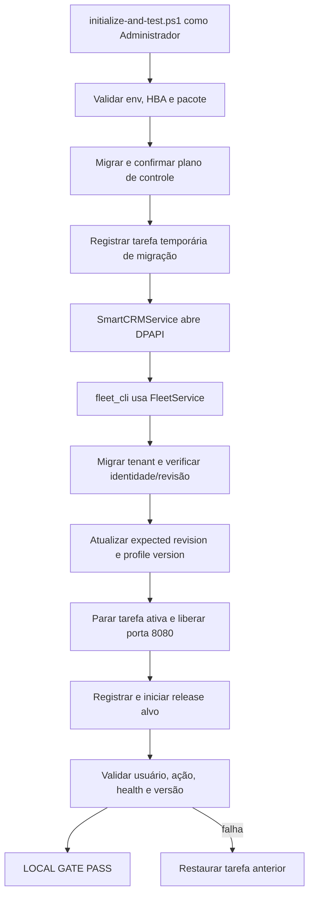

# Deployment Hardening v0.3.4 Design

**Spec**: `.specs/features/deployment-hardening-v034/spec.md`
**Status**: Approved

---

## Architecture Overview

O deploy terá dois processos separados. O PowerShell administrativo valida o servidor, migra o plano de controle e coordena tarefas. Uma tarefa temporária executada como `SmartCRMService` abre os segredos DPAPI e chama o `FleetService` para migrar tenants selecionados, verificar identidade/revisão e avançar o perfil central com compare-and-swap. Somente depois desse resultado o coordenador troca a tarefa principal e valida processo, health e versão.



O fluxo não executa Alembic no startup web. A tarefa temporária é explícita, finita e removida ao terminar.

---

## Code Reuse Analysis

### Existing Components to Leverage

| Component | Location | How to Use |
| --------- | -------- | ---------- |
| `FleetService` | `app/fleet.py` | Reutilizar seleção explícita, preflight, migração, verificação e compare-and-swap do perfil central. |
| `DpapiFileSecretProvider` | `app/security/secrets.py` | Abrir DSNs somente sob `SmartCRMService`. |
| `ControlDatabase` | `app/control_database.py` | Acessar plano central no CLI da frota. |
| Parser literal existente | `deploy/manual-windows-pg11/start-smart-crm.ps1` | Extrair para helper compartilhado sem `ConvertFrom-StringData`. |
| Processo nativo tolerante a stderr | `Invoke-SmartCrmLoggedProcess` em `deployment-policy.ps1` | Generalizar para comandos Alembic/CLI julgados por exit code. |
| Instalador da tarefa principal | `deploy/manual-windows-pg11/install-scheduled-task.ps1` | Registrar a ação definitiva da release alvo. |
| Gate de revisão | `Assert-SmartCrmAlembicRevision` | Confirmar a linhagem de controle. |
| API de versão | `GET /api/version` em `app/main.py` | Provar que a porta 8080 pertence à release alvo. |

### Integration Points

| System | Integration Method |
| ------ | ------------------ |
| PostgreSQL de controle | URL validada do `server.env`; Alembic de controle antes da frota. |
| PostgreSQL tenant | DSN DPAPI resolvido somente pela conta de serviço; `FleetService` por seleção explícita. |
| Task Scheduler | Tarefa temporária de migração com evidência redigida; tarefa `SmartCRM` para runtime. |
| Release imutável | `AppRoot` lado a lado; a ação final precisa referenciar exatamente esse caminho. |
| Health/version | HTTP loopback após a nova tarefa abrir a porta 8080. |

---

## Components

### Tenant repair migration

- **Purpose**: Corrigir seed ausente e payloads antigos sem reescrever migrações publicadas.
- **Location**: nova revisão em `migrations/versions/`, posterior a `f6b1d3a8c2e4`.
- **Interfaces**:
  - `upgrade()` obtém `workspace_id` de `tenant_identity`, configura `smartcrm.workspace_id` na transação, cria o funil somente se ausente e completa payloads de usuário.
  - Banco ainda não ativado, sem identidade nem usuários, avança sem reparo; banco com usuários e identidade ausente falha antes de qualquer escrita de workspace.
  - `downgrade()` não apaga dados de negócio reparados; apenas registra que a revisão é não destrutiva.
- **Dependencies**: tabelas `tenant_identity`, `workspaces`, `deal_pipelines`, `deal_pipeline_stages`, `crm_users`.
- **Reuses**: IDs determinísticos e nove etapas do contrato de `c7f3a9d8e2b1`.

### Canonical administrator payload

- **Purpose**: Criar e atualizar o administrador com o mesmo formato empacotado usado pelo workspace.
- **Location**: `app/admin_cli.py`.
- **Interfaces**:
  - `_admin_workspace_payload(admin, position=0) -> dict` retorna `{position, record}` sem credenciais.
- **Dependencies**: colunas canônicas de `CrmUser`.
- **Reuses**: contrato `_packed` de `app/repositories/workspace.py`, sem acoplar o admin à persistência completa do workspace.

### Fleet command-line adapter

- **Purpose**: Expor preflight e migração explícita sem criar rota web.
- **Location**: novo `app/fleet_cli.py`.
- **Interfaces**:
  - `preflight --tenant <slug>` produz apenas estado redigido.
  - `migrate --tenant <slug> --backup-acknowledged --confirmed` usa o head empacotado e retorna código diferente de zero se qualquer tenant não terminar em `migrated` ou `already_current`.
- **Dependencies**: `ControlDatabase`, `DpapiFileSecretProvider`, `FleetService`.
- **Reuses**: `format_preflight` e resultados estáveis de `app/fleet.py`.

### Service-account migration runner

- **Purpose**: Executar o CLI da frota no contexto DPAPI correto e devolver evidência redigida ao coordenador.
- **Location**: novos scripts em `deploy/manual-windows-pg11/`.
- **Interfaces**:
  - `run-fleet-migration.ps1` carrega ambiente, executa o CLI e grava um arquivo de resultado atômico.
  - `invoke-fleet-migration-task.ps1` registra tarefa temporária com credencial, espera estado final com timeout, valida resultado e remove a tarefa em `finally`.
- **Dependencies**: Task Scheduler, pasta `C:\ProgramData\SmartCRM\deploy`, `SmartCRMService`.
- **Reuses**: validação da conta dedicada e configuração da tarefa em `install-scheduled-task.ps1`.

### Deployment policy helpers

- **Purpose**: Centralizar contratos testáveis do Windows PowerShell 5.1.
- **Location**: `deploy/manual-windows-pg11/deployment-policy.ps1`.
- **Interfaces**:
  - `Read-SmartCrmEnvironment(Path, AllowedKeys)` preserva valores literais e rejeita duplicatas/chaves inválidas.
  - `Invoke-SmartCrmNativeProcess(...)` captura stdout/stderr, restaura `$ErrorActionPreference` e retorna exit code.
  - `Wait-SmartCrmPortReleased(...)` exige porta 8080 livre.
  - `Wait-SmartCrmReleaseReady(ExpectedVersion, ...)` exige health `ok` e versão exata.
  - `Assert-SmartCrmScheduledTaskTarget(...)` exige usuário e caminho alvo.
- **Dependencies**: Windows PowerShell 5.1, CIM/NetTCP, HTTP loopback.
- **Reuses**: helpers e mensagens já testados em `deployment-policy.ps1`.

### Cutover coordinator

- **Purpose**: Orquestrar controle, frota, parada, publicação, gate e restauração.
- **Location**: `deploy/manual-windows-pg11/initialize-and-test.ps1`.
- **Interfaces**:
  - parâmetros adicionais `TenantSlug`, `ExpectedVersion`, `BackupAcknowledged` e timeout.
  - saída final única `LOCAL GATE: PASS` apenas após todos os gates.
- **Dependencies**: componentes anteriores, `install-scheduled-task.ps1`, tarefa `SmartCRM` existente.
- **Reuses**: verificação HBA, Alembic de controle e release lado a lado.

---

## Data Models

### Fleet migration result file

```json
{
  "schemaVersion": 1,
  "releasePath": "C:\\brbots\\apps\\smart-crm-v0.3.4",
  "targetRevision": "<packaged-head>",
  "tenants": [
    {"slug": "brbots", "succeeded": true, "code": "migrated"}
  ],
  "exitCode": 0
}
```

O arquivo não contém DSN, senha, hash, token ou conteúdo DPAPI. O coordenador exige `schemaVersion`, caminho alvo, tenant solicitado e código permitido.

### Canonical CRM user payload

```json
{
  "position": 0,
  "record": {
    "id": "admin-...",
    "name": "Luiz Felipe",
    "email": "lfmarcon@brbots.com",
    "jobTitle": "",
    "role": "Administrador",
    "status": "Ativo",
    "avatar": "LF"
  }
}
```

Campos adicionais existentes em `record` são preservados durante o reparo. Credenciais nunca entram no JSON.

---

## Error Handling Strategy

| Error Scenario | Handling | User Impact |
| -------------- | -------- | ----------- |
| `server.env` inválido | Falhar antes de migração/tarefa, sem exibir valores | Mensagem identifica somente a chave/linha. |
| Controle não migra ou revisão diverge | Abortar antes da tarefa temporária | Release ativa permanece inalterada. |
| DPAPI ou tenant indisponível | CLI retorna código estável e evidência redigida | Cutover não inicia. |
| Migração tenant conclui mas verificação falha | Perfil central não avança | Operador recebe o código do tenant; runtime antigo não é trocado. |
| Tarefa temporária expira | Parar/remover tarefa temporária e falhar | Nenhuma tarefa principal é alterada. |
| Porta 8080 permanece ocupada | Abortar antes do registro da release nova | Processo conflitante precisa ser inspecionado. |
| Health ou versão final diverge | Restaurar e iniciar a tarefa anterior | `LOCAL GATE: PASS` não é emitido. |
| Restauração da tarefa anterior falha | Emitir erro composto com caminho do XML exportado | Operador tem artefato explícito para recuperação. |

---

## Risks & Concerns

| Concern | Location (file:line) | Impact | Mitigation |
| ------- | -------------------- | ------ | ---------- |
| Parser incompatível com caminhos Windows | `deploy/manual-windows-pg11/initialize-and-test.ps1:27` | Inicializador para antes da migração | Helper literal compartilhado e teste PS 5.1. |
| stderr informativo vira erro terminante | `deploy/manual-windows-pg11/initialize-and-test.ps1:43` | Alembic saudável é tratado como falha | Helper nativo julgado por exit code e testes com stderr. |
| Migração direta ignora metadados centrais | `deploy/manual-windows-pg11/initialize-and-test.ps1:46` | Router rejeita tenant após upgrade | Toda migração tenant passa por `FleetService`. |
| Seed publicado não enxerga workspace sob FORCE RLS | `migrations/versions/c7f3a9d8e2b1_add_customizable_deal_pipeline.py` | Funil ausente com migração marcada como concluída | Nova revisão obtém workspace de `tenant_identity` e repara de modo idempotente. |
| Admin criado com payload vazio | `app/admin_cli.py:302` | Usuário autentica, mas não aparece na UI | Payload canônico na criação/retomada e reparo de legados. |
| Health do app e gate divergentes | `deployment-policy.ps1:171`, `app/main.py` health | Gate falha depois de registrar tarefa | Gate usa contrato real `status=ok` e valida DB via disponibilidade central já embutida. |
| Processo antigo pode manter a porta | `install-scheduled-task.ps1` registra/inicia sem parada prévia | Release anterior responde após o cutover | Parada explícita, espera de porta e validação de versão. |
| Scripts novos podem faltar no pacote | `scripts/build_manual_windows_pg11_bundle.py` | Release local funciona, ZIP falha | Teste de manifesto/bundle exige todos os scripts e `app/fleet_cli.py`. |

---

## Tech Decisions

| Decision | Choice | Rationale |
| -------- | ------ | --------- |
| Identidade da migração | Tarefa temporária `SmartCRMService` | É a única identidade que pode abrir os segredos DPAPI do tenant. |
| Motor de migração | `FleetService`, não Alembic direto no inicializador | Mantém revisão tenant e perfil central sincronizados. |
| Reparação de produção | Nova migração posterior ao head publicado | Preserva a imutabilidade do histórico já aplicado. |
| Gate final | health + versão + ação + usuário + porta | Saúde isolada não prova qual release atende. |
| Numeração v0.3.4 | Não alterar `APP_VERSION` neste bloco | Outras funcionalidades ainda serão adicionadas antes da release. |
