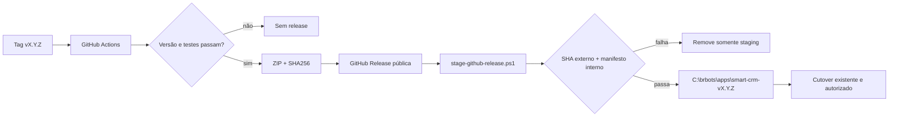

# GitHub Release Deployment Design

**Spec**: `.specs/features/github-release-deployment/spec.md`
**Status**: Approved

---

## Architecture Overview

Uma tag semântica aprovada dispara testes em Windows, constrói o mesmo pacote offline já validado e publica dois assets em uma GitHub Release. No servidor, um script pequeno consulta a tag pública, baixa ambos para uma pasta temporária, valida SHA-256 e manifesto e só então renomeia a staging para a pasta imutável final. A ativação continua sendo feita pelo `initialize-and-test.ps1` existente.

---

## Code Reuse Analysis

### Existing Components to Leverage

| Component | Location | How to Use |
| --------- | -------- | ---------- |
| Construtor determinístico | `scripts/build_manual_windows_pg11_bundle.py` | Aceitar versão explícita da tag e continuar produzindo ZIP + digest. |
| Manifesto interno | `deploy/manual-windows-pg11/test-package-integrity.ps1` | Validar a staging extraída antes da promoção. |
| Instalação offline | `deploy/manual-windows-pg11/install-offline.ps1` | Permanecer como passo posterior à preparação. |
| Cutover e health gate | `deploy/manual-windows-pg11/initialize-and-test.ps1` | Permanecer separado e reutilizado sem duplicar migrações. |
| Testes de deployment | `tests/backend/test_manual_windows_pg11_*.py` | Seguir o padrão de fixtures, subprocessos PowerShell e contratos de origem. |

### Integration Points

| System | Integration Method |
| ------ | ------------------ |
| GitHub Actions | Workflow em tag com `contents: write` apenas no job de publicação. |
| GitHub Releases | `gh release create --verify-tag` com os dois assets versionados. |
| Windows Server 2016 | REST pública + `Invoke-WebRequest` com TLS 1.2 e PowerShell 5.1. |
| Deploy existente | Pasta final alimenta `install-offline.ps1` e `initialize-and-test.ps1`. |

---

## Components

### Version-aware bundle builder

- **Purpose**: aceitar a identidade da tag pela CLI sem permitir caracteres inseguros em nomes de arquivo.
- **Location**: `scripts/build_manual_windows_pg11_bundle.py`
- **Interfaces**:
  - `validate_version(value: str) -> str` - aceita somente identificadores seguros.
  - `--version <tag>` - escolhe a identidade explícita; ausência mantém o SHA local.
- **Dependencies**: Python 3.11 e construtor atual.
- **Reuses**: `build()`, `git_version()` e ZIP determinístico existentes.

### Release workflow

- **Purpose**: validar versão, executar testes, construir e publicar uma release estável.
- **Location**: `.github/workflows/release-windows-pg11.yml`
- **Interfaces**:
  - evento `push.tags: v*`.
  - assets `dist/smart-crm-manual-pg11-<tag>.zip{,.sha256}`.
- **Dependencies**: runners GitHub-hosted Linux e Windows, PostgreSQL de servico, Python 3.11, Node 20, pnpm e GitHub CLI.
- **Reuses**: comandos de teste e build do repositório.

### Public release staging script

- **Purpose**: preparar uma pasta nova sem modificar a execução atual.
- **Location**: `deploy/manual-windows-pg11/stage-github-release.ps1`
- **Interfaces**:
  - `-Tag vX.Y.Z` obrigatório.
  - `-Repository owner/repo`, `-AppsRoot` e `-DownloadRoot` com defaults seguros.
  - funções puras para tag, metadados e digest, testáveis por dot-source.
- **Dependencies**: PowerShell 5.1, TLS 1.2, Expand-Archive e API pública do GitHub.
- **Reuses**: `test-package-integrity.ps1` dentro do próprio pacote baixado.

### Operator runbook

- **Purpose**: reduzir o preparo da release a comandos curtos e manter explícita a fronteira de produção.
- **Location**: `deploy/manual-windows-pg11/LEIA-ME.md`
- **Interfaces**: sequência tag → bootstrap imutável → staging → cutover existente.
- **Dependencies**: workflow publicado e autorização operacional.
- **Reuses**: seções atuais de backup, instalação, migração e rollback.

---

## Error Handling Strategy

| Error Scenario | Handling | User Impact |
| -------------- | -------- | ------------ |
| Tag diverge de `APP_VERSION` | Workflow falha antes dos testes/build | Nenhuma release é publicada. |
| Teste ou build falha | Job encerra antes de `gh release create` | Release anterior permanece latest. |
| GitHub/API indisponível | PowerShell lança erro antes da promoção | Aplicação ativa permanece intacta. |
| Release draft/prerelease ou assets ambíguos | Metadados rejeitados | Nenhum ZIP é extraído. |
| Digest externo inválido | Hash rejeitado | Staging temporária é removida. |
| Manifesto interno inválido | Verificador empacotado falha | Pasta final não é criada. |
| Pasta final já existe | Operação falha sem `-Force` | Release existente não é tocada. |

---

## Risks & Concerns

| Concern | Location (file:line) | Impact | Mitigation |
| ------- | -------------------- | ------ | ---------- |
| O construtor aceitava qualquer texto em `version` | `scripts/build_manual_windows_pg11_bundle.py:164` | Uma versão fornecida externamente poderia formar nome de arquivo inseguro. | Validar o identificador antes de criar caminhos. |
| O servidor usa Windows PowerShell 5.1 | `deploy/manual-windows-pg11/LEIA-ME.md:38` | TLS e comportamento de comandos diferem do PowerShell moderno. | Forçar TLS 1.2 e testar via `powershell.exe` 5.1. |
| O inicializador altera schemas e tarefa | `deploy/manual-windows-pg11/initialize-and-test.ps1:1` | Acoplar rede e cutover aumentaria indisponibilidade e rollback parcial. | Manter staging e ativação como fases distintas. |
| Release pública expõe todo asset enviado | `.github/workflows/release-windows-pg11.yml` | Um segredo empacotado se tornaria público. | Manter allowlist do builder, testes de ausência e apenas dois assets. |

---

## Tech Decisions

| Decision | Choice | Rationale |
| -------- | ------ | --------- |
| Publicador | GitHub CLI `gh release create --verify-tag` | É disponibilizado no runner e falha se a tag remota não existir. |
| Autenticação do servidor | Nenhuma | O repositório é público; não há PAT para guardar ou rotacionar. |
| Unidade de instalação | Pasta `smart-crm-vX.Y.Z` | Liga diretamente a pasta ao release tag e mantém rollback lado a lado. |
| Promoção | Rename após duas validações | A pasta final só aparece depois do SHA externo e manifesto interno passarem. |
| Ativação | Separada do download | Mantém banco e disponibilidade fora do blast radius de rede. |

