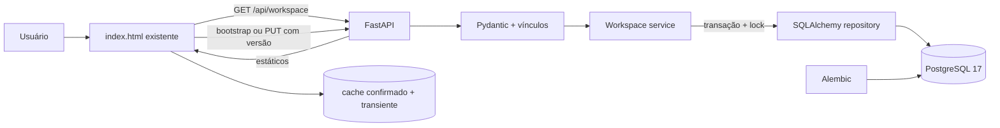
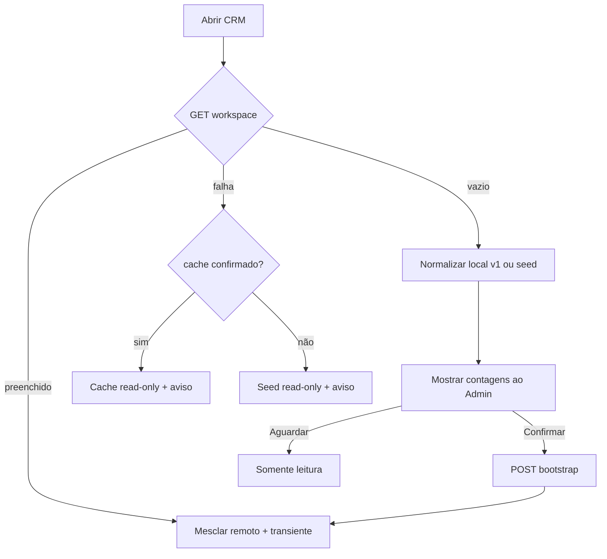

# Persistência do Smart CRM no PostgreSQL - Design

**Spec**: `.specs/features/postgres-crm-persistence/spec.md`  
**Status**: Approved

---

## Architecture Overview

A interface atual continua no mesmo container, mas o servidor estático é substituído por FastAPI. O navegador mantém somente estado transitório e um cache da última versão confirmada; dados comerciais e preferências duráveis são lidos e gravados como um agregado versionado no PostgreSQL.

### Alternativas avaliadas

| Abordagem | Vantagens | Limitações | Decisão |
| --- | --- | --- | --- |
| FastAPI + SQLAlchemy 2 + Psycopg 3 + Alembic | Contratos tipados, transações e migrações maduras; preserva o frontend | Adiciona dependências e repositório | **Escolhida**, dentro da abordagem Python + tabelas normalizadas aprovada |
| Servidor atual + SQL manual com Psycopg | Menor alteração inicial | Validação, erros e migrações manuais e frágeis | Rejeitada |
| Django + DRF | Ecossistema completo | Substituição desproporcional e maior risco visual | Rejeitada |

### Evidência técnica consultada

- FastAPI suporta arquivos estáticos junto das rotas da API.
- SQLAlchemy 2 delimita unidades atômicas com `Session.begin()`/`Engine.begin()`, confirmando no sucesso e revertendo em exceções.
- Alembic mantém revisões de banco ordenadas e versionadas com a aplicação.
- PostgreSQL fornece integridade por PKs, FKs, unicidade e `CHECK`.

---

## State Boundary

### PostgreSQL

- usuários, equipes, Leads, Contatos, Empresas, Negócios e responsáveis;
- assistentes, histórico de etapa, orçamentos e notificações;
- definições, valores e visibilidade de campos personalizados;
- linhas originais do Bitrix com nome, ocorrência, posição e valor para round-trip sem perda;
- filtros nomeados, Lista/Kanban, escopo do painel e configuração geral de campos.

### Navegador

- `currentUserId` do perfil demonstrativo;
- busca e filtros aplicados mas não salvos (`filtersByUser`);
- tela, drawer/modal/aba, rascunhos e undo não confirmado;
- cache do último agregado confirmado e versão.

`extractDurableState()` e `mergeDurableState()` separam essas fronteiras.

---

## Code Reuse Analysis

| Componente | Local | Reuso |
| --- | --- | --- |
| Seed e normalização | `app/static/index.html:594`, `:653` | `seedState()` fornece massa fictícia; `normalizeState()` prepara legado e resposta |
| Fluxos de negócio | `app/static/index.html:1299-2106` | Manter usuários, campos, conversão, etapas, CSV, orçamentos e notificações |
| Cache local | `app/static/index.html:731-748` | Migrar a chave v1 uma vez e guardar snapshots confirmados |
| Cabeçalhos/estáticos | `app/server.py` | Preservar raiz, CSP, `nosniff`, referrer e logs em FastAPI |
| Compose | `compose.yaml` | Reusar PostgreSQL, healthcheck e volume sem apagar `_smartcrm_test_probe` |
| Verificação | `scripts/verify_demo.py` | Estender saúde, schema, contagens e reinícios |
| Regressão | `tests/ui-prototype.spec.cjs` | Manter 55 cenários e adicionar persistência/falhas |

### Integration Points

| Sistema | Integração |
| --- | --- |
| Browser  API | JSON no mesmo host em `/api/workspace`, sem CORS |
| API  PostgreSQL | SQLAlchemy síncrono, `postgresql+psycopg://`, `pool_pre_ping=True` |
| App  Alembic | `MigrationService.ensure_current()` no início e antes de DB; falha não impede servir UI |
| Testes  API | reset canônico e limpeza somente quando `SMART_CRM_TEST_MODE=1` |

---

## Components

### Application factory - `app/main.py`

Cria FastAPI, cabeçalhos, limite de corpo, rotas e arquivos estáticos. Interfaces: `create_app(settings=None)` e `GET /health`.

### Settings/database - `app/config.py`, `app/database.py`

Lê `SMART_CRM_DATABASE_URL`, modo de teste e limites; fornece engine, `session_scope()` e `check_database()`.

### Migration service - `app/migrations.py`, `alembic.ini`, `migrations/`

Verifica/aplica Alembic com lock no processo. Banco indisponível não derruba os estáticos; a tentativa se repete antes de operações de banco.

### Schemas/validator - `app/schemas.py`, `app/validation.py`

Pydantic valida tipos e formato. `validate_references()` valida IDs únicos, responsáveis, assistentes, definições/valores e links antes da transação. `count_state()` produz as contagens contratuais.

### Workspace service - `app/services/workspace.py`

Orquestra `load()`, `bootstrap()`, `save()`, `reset()`, `list_deleted()` e `restore()`, incluindo versão e envelopes de erro.

### Repository/serializer - `app/repositories/workspace.py`, `app/models.py`

`read_active()` reconstrói o estado; `reconcile()` atualiza presentes; `soft_delete_missing()` marca ausentes; `restore_record()` recupera. Mantém ordem de arrays e IDs textuais.

### Browser persistence adapter - `app/static/index.html`

`initializeWorkspace()`, `persistMutation()`, `extractDurableState()`, `mergeDurableState()` e `writeConfirmedCache()` reutilizam clone/normalize/render/toast.

---

## Data Models

Tabelas comerciais incluem `workspace_id`, timestamps UTC e, quando removíveis, `deleted_at`. FKs usam `ON DELETE RESTRICT`; exclusões são lógicas.

| Tabela | Colunas/relações essenciais |
| --- | --- |
| `workspaces` | singleton `default`, versão >= 0, `initialized_at`, timestamps |
| `teams` | nome único por workspace |
| `crm_users` | equipe, nome, email, cargo, role, status, convite, `deleted_at`; email ativo único |
| `leads` | padrão atual, responsável/equipe, origem Bitrix, `deleted_at` |
| `contacts` | padrão atual, `company_id` opcional + texto preservado, origem Bitrix, `deleted_at` |
| `companies` | padrão atual, owner, origem Bitrix, `deleted_at` |
| `deals` | padrão atual, FKs opcionais + nomes preservados, etapa/datas, origem Bitrix, `NUMERIC(18,2)`, `deleted_at` |
| `lead_assistants`, `deal_assistants` | registro, usuário, posição; PK composta e FKs |
| `deal_stage_history` | negócio, posição, etapas, data e usuário |
| `quotes` | negócio, descrição, quantidade/preços, validade, estado, nome PDF, `deleted_at` |
| `notifications` | usuário, texto, detalhe, horário exibido, lida, `deleted_at` |
| `custom_field_definitions` | módulo, chave, label, tipo, opções JSONB, origem, ocorrência, ordem, user-created, `deleted_at` |
| `custom_field_values` | módulo, registro, chave, valor JSONB, posição; preserva vazio, false, lista e null |
| `record_visible_custom_fields` | módulo, registro, chave e posição |
| `external_source_fields` | módulo, registro, source, nome, ocorrência, posição e valor; reconstrói `bitrixFields` |
| `module_field_settings` | módulo e arrays JSONB de campos ocultos |
| `saved_filters` | usuário, escopo, nome, filtro JSONB, data e `deleted_at` |
| `user_module_preferences` | usuário, módulo, Lista/Kanban |
| `user_dashboard_preferences` | usuário e escopo all/leads/deals |

Índices cobrem workspace + `deleted_at`, responsáveis, equipe, etapa, datas, `bitrix_id` e FKs. Busca no servidor/paginação ficam para a API granular posterior; filtros atuais continuam no browser sobre a massa carregada.

---

## API Contract

| Rota | Sucesso | Falhas |
| --- | --- | --- |
| `GET /health` | 200 `{status:"ok",database:"ok"}` | 503 `{status:"degraded",database:"unavailable"}` |
| `GET /api/workspace` | 200 não inicializado ou `{initialized:true,version,state}` | 503 + errorId |
| `POST /api/workspace/bootstrap` | 201 `{version:1,counts,state}` | 409/413/422/503 |
| `PUT /api/workspace` | 200 com versão +1 e estado canônico | 409 currentVersion, 422, 500/503 |
| `POST /api/workspace/reset` | 200 com versão +1 | 409/422/503 |
| `GET /api/workspace/deleted?module=` | 200 lista removidos | 422/503 |
| `POST /api/workspace/restore` | 200 agregado e versão +1 | 404/409/422/503 |

Erros: `{error:{code,message,errorId?,path?,currentVersion?}}`. `errorId` é UUID correlacionado ao log; detalhes internos não saem.

---

## Transactions and Concurrency

### Bootstrap

1. Middleware rejeita `Content-Length` e stream acima de 25 MB antes da transação.
2. Pydantic e referências validam o agregado.
3. A transação bloqueia `workspaces/default` com `SELECT FOR UPDATE`.
4. `initialized_at` preenchido gera 409.
5. O repositório insere tudo, marca versão 1 e confirma uma vez.
6. Contagens vêm do estado persistido.

### Save

1. Cliente guarda `confirmedState`/versão, aplica mutação numa cópia e bloqueia escrita paralela na mesma aba.
2. API valida e bloqueia workspace.
3. Versão divergente retorna 409 antes de reconciliar.
4. Presentes são upsertados e reativados; filhos dos presentes são reconciliados em ordem.
5. Ativos ausentes recebem `deleted_at`; filhos permanecem para recuperação.
6. Versão muda por `UPDATE ... WHERE version=:expected RETURNING`; uma linha deve mudar.
7. Toast/cache só após resposta. Falha restaura snapshot; conflito informa e recarrega o servidor.

### Restore

Bloqueia/valida versão, limpa `deleted_at`, mantém filhos, verifica unicidade, incrementa uma vez e devolve o agregado.

---

## Browser Flows

- `saveState()` vira `saveTransientState()`, `writeConfirmedCache()` e `persistMutation()`.
- Busca, perfil e filtros temporários não chamam API.
- Cadastros, usuários, filtros nomeados, preferências, campos, conversão, etapa/undo, CSV, orçamento e notificações usam uma mutação agregada.
- `notify()` não faz I/O; o chamador confirma uma vez.
- Controles mutáveis ficam desabilitados durante o write; não há confirmação antecipada.

---

## Error Handling

| Cenário | Tratamento e interface |
| --- | --- |
| DB falha na carga | servir UI, API 503, usar cache e banner `Banco indisponível. Alterações bloqueadas.` |
| DB falha na escrita | rollback DB/visual e `Não foi possível salvar no banco.` |
| Versão antiga | 409, nenhuma mudança, aviso e recarga canônica |
| Payload inválido | 422 com caminho; manter interface e mostrar validação |
| >25 MB | 413 antes da transação |
| Erro inesperado | rollback, errorId e log; mensagem genérica com ID |
| Migração indisponível | UI continua disponível e schema é tentado novamente |

---

## Test Strategy

### Backend

- pytest com PostgreSQL real, sem SQLite, incluindo migração do zero;
- round-trip com tipos customizados, Bitrix vazio/repetido e vínculos;
- bootstrap concorrente/inválido/>25 MB, versão antiga, falha intermediária e rollback;
- soft delete/restore, reset, constraints, contagens, saúde normal/degradada e errorId;
- comparação direta por SQL.

### Browser

- aguardar `data-workspace-ready` e restaurar seed antes de cada cenário;
- manter os 55 cenários sem retirar asserts;
- trocar asserts de fonte local por cache confirmado + API;
- adicionar bootstrap, segundo contexto, conflito, read-only e rollback;
- limpeza do singleton apenas com `SMART_CRM_TEST_MODE=1`.

### Gates

1. Alembic em banco vazio;
2. testes Python;
3. `scripts/verify_demo.py`;
4. Playwright completo;
5. SQL e reinício de `crm`/`postgres` sem remover volume;
6. Verifier independente e mutantes de versão, rollback, cache e campos ocultos.

---

## Risks & Concerns

| Concern | Location | Impact | Mitigation |
| --- | --- | --- | --- |
| Estado/render/persistência monolíticos | `app/static/index.html:500-2180` | Busca poderia virar write ou falha parecer sucesso | Adaptador único e classificação de cada `saveState()` |
| Ações salvam mais de uma vez | `:1076-1080`, `:1660-1695`, `:1732-1770`, `:2080-2091` | Versão dupla/estado parcial | `notify()` sem I/O e uma mutação por ação |
| Exclusão física atual | `:1704-1710` | Perda de vínculos | Repositório marca ausentes e endpoint recupera |
| Testes isolam por localStorage | `tests/ui-prototype.spec.cjs:17-39` | DB vaza entre testes | Reset canônico e testes cross-context |
| Testes legados alteram cache | `tests/ui-prototype.spec.cjs:76-149` | DB deve prevalecer | Normalização no bootstrap vazio; teste explícito DB-wins |
| Sem autenticação real | perfis demonstrativos | Perfis não são segurança | Ambiente local e limitação documentada |
| Agregado não escala ao Bitrix total | `/api/workspace` | Crescimento linear | 25 MB e escopo de teste; API granular posterior |
| Migração bloqueante derrubaria offline | novo backend | Sem UI não há cache | App inicia sem DB e tenta migração novamente |
| Empresa/Contato por texto e ID | `:603-627`, `:1714-1728` | Associação ambígua | Preservar texto; FK só se determinística |

---

## Tech Decisions

| Decisão | Escolha | Motivo |
| --- | --- | --- |
| HTTP | FastAPI síncrono/Uvicorn | Estáticos + API, validação e testes |
| Banco | SQLAlchemy 2/Psycopg 3 | Transações e PostgreSQL nativo |
| Schema | Alembic | Revisões sem `create_all()` |
| Escrita | Agregado versionado | Menor risco aos fluxos atuais |
| Concorrência | lock + versão otimista | Um vencedor e 409 determinístico |
| Custom values | definição relacional + JSONB | Tipo/ordem e valor preservados |
| Falha inicial | servir UI + retry de migration | Cache read-only quando DB cai |

A stack foi registrada como decisão de projeto AD-003.

---

## Requirement Mapping

| Requisitos | Design |
| --- | --- |
| DBP-01 | Alembic, migration service e Data Models |
| DBP-02-06 | bootstrap, validação e limite |
| DBP-07-11 | carga, persistMutation, lock/versão, transação e errorId |
| DBP-12-13 | deleted_at e recuperação |
| DBP-14 | serializer, campos externos/custom e round-trip |
| DBP-15-16 | State Boundary e cache |
| DBP-17 | todas as mutações e Playwright |
| DBP-18 | volume e reinícios |
| DBP-19-20 | health |
| DBP-21-22 | degradado e rollback |
| DBP-23 | erro/log correlacionado |

**Coverage:** 23/23 requisitos desenhados.

