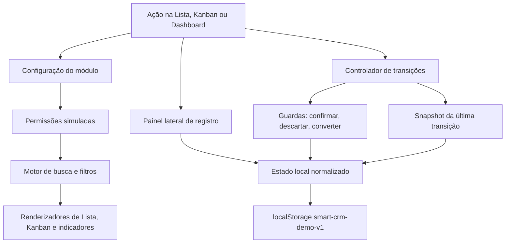

# Evolução da Área de Trabalho do CRM — Design

**Spec**: `.specs/features/ui-crm-workspace/spec.md`  
**Status**: Approved

---

## Abordagem aprovada

O protótipo continuará autocontido em `app/static/index.html`, sem framework e sem dependências de execução no navegador. A evolução será incremental: o estado atual, os renderizadores e os fluxos já validados serão estendidos por registros de configuração e componentes internos compartilhados. Não haverá reimplementação da aplicação.

As alternativas descartadas foram separar agora todo o CSS e JavaScript, que ampliaria o diff sem entregar comportamento adicional, e reconstruir a interface com um framework, que introduziria toolchain e risco desnecessários para uma demonstração local.

## Architecture Overview



O registro de configuração descreve os campos de cada módulo uma única vez. O painel lateral, o filtro configurável, a busca global e os renderizadores consultam esse registro. A regra evita duplicar rótulos, tipos, opções e caminhos de leitura em quatro implementações diferentes.

## Code Reuse Analysis

### Existing Components to Leverage

| Component | Location | How to Use |
| --- | --- | --- |
| `seedState`, `loadState`, `saveState` | `app/static/index.html` | Normalizar novos campos de data e preferências sem trocar a chave de armazenamento. |
| `canSee`, `visibleLeads`, `visibleDeals` | `app/static/index.html` | Aplicar autorização simulada antes de busca, filtros, Kanban e Dashboard. |
| `entityFields`, `fieldHTML`, `saveEntity` | `app/static/index.html` | Alimentar o painel lateral com os mesmos campos e regras atuais de CRUD. |
| `changeDealStage`, `convertLead`, `discardLead` | `app/static/index.html` | Encapsular no novo controlador de transições, preservando automações e payloads. |
| `renderDashboard`, `renderLeads`, `renderDeals` | `app/static/index.html` | Consumir o conjunto já filtrado em vez de duplicar regras de seleção. |
| `toast`, `notify`, dialogs de orçamento | `app/static/index.html` | Manter feedback e fluxos já validados. |
| Suíte Playwright | `tests/ui-prototype.spec.cjs` | Preservar os 15 casos existentes e adicionar casos ancorados nos 36 novos requisitos. |

### Integration Points

| System | Integration Method |
| --- | --- |
| Estado demonstrativo | Mesmo objeto serializado na chave `smart-crm-demo-v1`, com normalização ao carregar. |
| Container | Nenhuma mudança de arquitetura; o servidor Python continuará entregando o documento estático. |
| Build gate | `scripts/verify_demo.py` continuará validando Compose, saúde e documento raiz. |

## Components

### Registry de módulos e campos

- **Purpose**: declarar campos, tipos, rótulos, opções, operadores, busca e edição por módulo.
- **Location**: `app/static/index.html`, seção JavaScript `entityConfigs`.
- **Interfaces**:
  - `entityConfigs[scope]` — metadados de Leads, Contatos, Empresas, Negócios e Dashboard.
  - `fieldValue(scope, record, fieldName)` — resolve valores simples, responsáveis, Assistentes e vínculos.
  - `searchableValues(scope, record)` — retorna todos os valores textuais indexáveis.
- **Dependencies**: `state.users`, Pipelines fixas e formatadores existentes.
- **Reuses**: `entityFields`, `userName`, `leadStages`, `dealStages`.

### Normalizador de estado demonstrativo

- **Purpose**: tornar estados já existentes compatíveis com datas canônicas, histórico mínimo e preferências de interface.
- **Location**: `app/static/index.html`, junto de `loadState`.
- **Interfaces**:
  - `normalizeState(rawState): State` — adiciona somente campos ausentes e preserva dados manipulados.
  - `defaultUiState(): UiState` — cria filtros, visualizações e filtros salvos por usuário/módulo.
- **Dependencies**: massa fictícia atual.
- **Reuses**: `seedState`, `STORAGE_KEY`.

### Motor de filtros

- **Purpose**: executar busca global, operadores tipados e combinações `E`/`OU` sobre registros já autorizados.
- **Location**: `app/static/index.html`, seção JavaScript de filtros.
- **Interfaces**:
  - `applyRecordFilters(scope, records, filterState): Record[]` — aplica todos os critérios ativos.
  - `matchesCriterion(record, definition, criterion): boolean` — avalia texto, seleção, data e número.
  - `saveNamedFilter(scope, name)` — persiste ou atualiza o filtro do usuário atual.
  - `loadNamedFilter(scope, id)` e `deleteNamedFilter(scope, id)` — gerenciam presets.
- **Dependencies**: registry, estado de interface e `canSee`.
- **Reuses**: formatadores e funções de visibilidade.

### Painel configurável de filtros

- **Purpose**: oferecer filtros salvos, campos padrão, adição/remoção de campos, pesquisa e redefinição.
- **Location**: `app/static/index.html`, novo `dialog#filterDialog` e renderizadores associados.
- **Interfaces**:
  - `openFilterPanel(scope)` — abre o painel no escopo atual.
  - `renderFilterPanel()` — monta sidebar de presets e controles por tipo.
  - `applyFilterPanel()` — valida intervalos, persiste o rascunho e renderiza a página.
- **Dependencies**: registry e motor de filtros.
- **Reuses**: estilos de dialog, `.field`, `.button` e `toast`.

### Painel lateral de registro

- **Purpose**: substituir a edição pelo lápis por uma área ampla acionada pelo nome.
- **Location**: `app/static/index.html`, novo `aside#entityDrawer` com overlay.
- **Interfaces**:
  - `openEntityDrawer(entity, id)` — carrega o registro e a assinatura inicial do formulário.
  - `closeEntityDrawer({ force })` — bloqueia descarte silencioso quando o formulário mudou.
  - `saveDrawerEntity(form)` — reutiliza validação e persistência do CRUD atual.
- **Dependencies**: registry e estado local.
- **Reuses**: `entityFields`, `fieldHTML`, `saveEntity` e estilos de formulário.

### Renderizadores Lista/Kanban

- **Purpose**: alternar visualizações preservando filtros e representar a Pipeline visualmente.
- **Location**: `app/static/index.html`, renderizadores de Leads e Negócios.
- **Interfaces**:
  - `renderStageProgress(stages, current, entity, id)` — barra segmentada clicável e rotulada.
  - `renderKanban(scope, records)` — colunas e cards por etapa.
  - `setViewMode(scope, mode)` — persiste `list` ou `kanban` por usuário/módulo.
- **Dependencies**: motor de filtros e controlador de transições.
- **Reuses**: tabelas, `stageTag`, `money`, `initials` e ações de orçamento/conversão.

### Controlador transacional de etapas

- **Purpose**: centralizar guardas, automações, histórico de mudança e reversão da última transição.
- **Location**: `app/static/index.html`, substituindo chamadas diretas a `changeDealStage`.
- **Interfaces**:
  - `requestStageChange(entity, id, targetStage)` — escolhe o fluxo comum ou protegido.
  - `commitStageChange(entity, record, targetStage)` — grava etapa, datas, histórico e automações.
  - `undoLastStageChange()` — restaura registro e notificações do snapshot em memória.
- **Dependencies**: Pipelines, `notify`, conversão e descarte.
- **Reuses**: comportamento atual de Faturamento e criação de Negócio.

### Dashboard filtrável

- **Purpose**: recalcular indicadores e gráficos pelo escopo e critérios configurados.
- **Location**: `app/static/index.html`, extensão de `renderDashboard`.
- **Interfaces**:
  - `dashboardRecords(scope)` — retorna Leads e/ou Negócios autorizados e filtrados.
  - `renderDashboard()` — consome apenas o recorte retornado.
- **Dependencies**: motor de filtros e registry.
- **Reuses**: cards, gráfico de Pipeline e lista de movimentações.

## Data Models

### FieldDefinition

```text
FieldDefinition {
  name: string
  label: string
  type: text | select | multiselect | date | number | money
  operators: string[]
  options?: function
  searchable: boolean
  defaultFilter: boolean
  path?: string
}
```

### FilterState

```text
FilterState {
  query: string
  scope: dashboard | leads | contacts | companies | deals
  visibleFields: string[]
  criteria: {
    [fieldName]: { operator: string, value: unknown, valueTo?: unknown }
  }
}
```

### SavedFilter

```text
SavedFilter {
  id: string
  name: string
  userId: string
  scope: string
  filter: FilterState
  updatedAt: ISODateTime
}
```

### UiState

```text
UiState {
  filtersByUser: { [userId]: { [scope]: FilterState } }
  savedFilters: SavedFilter[]
  viewModesByUser: { [userId]: { leads: list | kanban, deals: list | kanban } }
  dashboardScopeByUser: { [userId]: all | leads | deals }
}
```

### StageMetadata

```text
StageMetadata {
  createdAt: ISODateTime
  updatedAt: ISODateTime
  stageChangedAt: ISODateTime
  stageChangedById: string
  wonAt?: ISODateTime
  stageHistory: Array<{ from: string, to: string, at: ISODateTime, byId: string }>
}
```

O normalizador adicionará datas ISO determinísticas aos registros fictícios antigos. A interface continuará exibindo datas em português do Brasil.

## Error Handling Strategy

| Error Scenario | Handling | User Impact |
| --- | --- | --- |
| Intervalo de data ou valor invertido | Bloquear aplicação e destacar o campo | Mensagem explica que o início deve ser menor ou igual ao fim. |
| Nome vazio ao salvar filtro | Bloquear persistência | Aviso solicita um nome. |
| Campo salvo não existe mais | Remover o critério incompatível ao carregar | Aviso informa que o filtro foi ajustado. |
| Fechamento com formulário alterado | Exigir confirmação | Usuário escolhe continuar editando ou descartar. |
| Transição protegida cancelada | Não mutar registro ou notificações | O card permanece na etapa original. |
| `localStorage` corrompido | Reutilizar recuperação existente | Massa inicial e preferências padrão são restauradas. |

## Risks & Concerns

| Concern | Location (file:line) | Impact | Mitigation |
| --- | --- | --- | --- |
| CSS, HTML e lógica estão concentrados em um documento grande | `app/static/index.html:1` | Mudanças amplas podem acoplar renderização e estado | Criar seções internas claras e um registry compartilhado; evitar refatorar comportamento não relacionado. |
| Datas atuais são textos relativos, como `Hoje` e `Há 18 min` | `app/static/index.html:333`, `app/static/index.html:352` | Filtros por período não seriam determinísticos | Normalizar datas ISO e formatar somente na apresentação. |
| Filtros atuais são variáveis globais não persistidas | `app/static/index.html:368` | Recarregar perde critérios e não suporta presets | Migrar preferências para `state.ui`, mantendo normalização retrocompatível. |
| Mudanças de etapa são gravadas diretamente e não possuem snapshot | `app/static/index.html:631` | Não há confirmação uniforme nem reversão atômica | Centralizar transições e capturar registro mais tamanho das notificações antes da mutação. |
| Testes antigos dependem do lápis e do seletor de etapa removidos pela nova especificação | `tests/ui-prototype.spec.cjs:113`, `tests/ui-prototype.spec.cjs:177` | Seletores deixam de representar o comportamento aprovado | Atualizar somente a interação dos casos existentes, preservando ou fortalecendo as mesmas asserções de resultado. |
| HTML5 drag-and-drop tem suporte limitado em telas móveis | `app/static/index.html` | Usuários móveis podem não conseguir arrastar cards | Manter ação acessível de mudança de etapa no card e exigir apenas rolagem horizontal no viewport móvel. |

## Tech Decisions

| Decision | Choice | Rationale |
| --- | --- | --- |
| Arquitetura do protótipo | Extensão incremental do documento autocontido | Preserva execução sem build e reduz o risco sobre o protótipo concluído. |
| Fonte de metadados | Registry único por módulo | Painel, filtros, busca e Dashboard compartilham tipos e opções. |
| Datas filtráveis | ISO no estado, `pt-BR` na apresentação | Comparações permanecem determinísticas sem perder legibilidade. |
| Undo | Um snapshot em memória da última transição | Cumpre o escopo sem criar histórico de comandos persistente. |
| Testes antigos afetados | Trocar a interação, manter ou fortalecer o resultado | A nova especificação substitui lápis e seletor sem reduzir cobertura comportamental. |

Nenhuma decisão deste design altera a arquitetura do MVP produtivo; portanto, não é necessário acrescentar um `AD-NNN` ao `STATE.md`.
