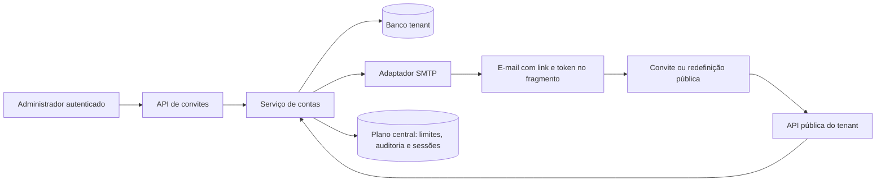

# Convites de usuários e recuperação de senha — Design

**Spec**: `.specs/features/user-invitations-password-recovery/spec.md`  
**Status**: Approved

---

## Architecture Overview

A implementação seguirá a primeira opção aprovada: usuários, convites, tokens de recuperação e seus estados serão persistidos no banco PostgreSQL exclusivo de cada empresa. O plano de controle central continuará sendo a autoridade para localizar o tenant, limitar abuso, revogar sessões e registrar auditoria de segurança, sem armazenar credenciais comerciais nem tokens de ação.

O token bruto existirá somente na memória durante a geração e no link entregue por e-mail. O link usará fragmento (`#token=...`), que não é enviado no `GET` nem aparece no access log do servidor. O navegador extrairá o token e o enviará no corpo de um `POST`; o banco guardará somente um digest SHA-256 com separação por finalidade.



### Fluxo de convite e entrega

1. A API confirma sessão, origem, tenant e perfil `Administrador`.
2. Em uma transação tenant, o serviço bloqueia por e-mail normalizado, aplica a regra do estado atual, invalida tokens anteriores e cria usuário `Pendente` e token com `delivery_status=pending`.
3. A transação é confirmada antes da chamada externa. O SMTP é chamado com timeout limitado e fora da transação.
4. Uma segunda transação marca o token como `sent` ou o invalida como `failed`. Falha deixa o usuário `Pendente` e permite reenvio.
5. Se o processo cair entre persistência e envio, o estado `pending` não afirma entrega; um reenvio administrativo substitui o token com segurança.

### Fluxo de aceite e redefinição

1. O caminho público contém somente o slug; o token fica no fragmento do navegador.
2. A API localiza o tenant pelo plano central e abre somente o banco indicado pelo perfil confiável do servidor.
3. Em uma única transação tenant, o serviço seleciona token e usuário `FOR UPDATE`, compara o digest em tempo constante, valida finalidade, tenant, estado e expiração e consome o token.
4. Aceite grava apenas hash Argon2id, ativa a conta e incrementa `auth_version`. Redefinição substitui o hash e também incrementa `auth_version`.
5. Na redefinição, o incremento torna sessões antigas inválidas na próxima resolução de principal mesmo se a limpeza central atrasar; em seguida o plano central revoga explicitamente todas as sessões do usuário.
6. O navegador retorna à tela de login da empresa, sem autenticação automática.

### Limites de confiança

- O slug vindo do navegador nunca seleciona diretamente uma conexão; ele é resolvido pelo plano central e pelo `TenantDatabaseRouter`.
- O navegador não pode gravar `password_hash`, `auth_enabled`, `auth_version`, estado de entrega ou tokens pelo snapshot do workspace.
- Convite, reenvio, cancelamento e reativação exigem a ação administrativa do servidor; a interface apenas chama APIs.
- Solicitação de recuperação sempre retorna `202` e a mesma mensagem pública.

---

## Code Reuse Analysis

### Existing Components to Leverage

| Component | Location | How to Use |
| --------- | -------- | ---------- |
| Roteamento tenant confiável | `app/tenant_database.py` | Abrir transações no banco correto, confirmar identidade e revisão antes de acessar usuários ou tokens. |
| Autenticação e sessões opacas | `app/services/auth.py` | Reusar normalização, verificação de conta, `auth_version`, revogação e contexto do tenant. |
| Throttle central | `app/control_database.py` | Generalizar o repositório atual para buckets de convite e recuperação, mantendo somente digests. |
| Auditoria de segurança | `app/services/auth.py` e `app/control_database.py` | Registrar resultados redigidos com tenant, usuário e digest de correlação. |
| Hash de senha | `app/security/passwords.py` | Reusar Argon2id e alinhar a política global aprovada para 8–128 caracteres. |
| DPAPI por conta de serviço | `app/security/secrets.py` | Proteger e abrir a credencial SMTP sob `SmartCRMService`, sem senha no Git ou no `server.env`. |
| Políticas de autorização | `app/policies.py` | Reusar `MANAGE_USERS` e restringir as novas rotas administrativas a `Administrador`. |
| UI existente de usuários e login | `app/static/index.html` | Substituir somente a simulação por APIs e acrescentar as vistas públicas, preservando o layout já validado. |
| Testes PostgreSQL e UI | `tests/backend/` e `tests/ui-prototype.spec.cjs` | Estender fixtures existentes com SMTP em memória e cenários E2E determinísticos. |

### Integration Points

| System | Integration Method |
| ------ | ------------------ |
| Banco tenant | Nova migration Alembic depois do head tenant atual; tabela de tokens com RLS e índices por workspace, usuário, finalidade e digest. |
| Plano central | Resolução de slug, throttling, eventos de segurança e revogação das sessões existentes. |
| SMTP | Adaptador síncrono isolado com `smtplib`, TLS obrigatório e timeout configurável; fake injetável nos testes. |
| FastAPI | Novos contratos Pydantic e rotas administrativas/públicas em `app/main.py`, delegando regras para serviços. |
| Workspace snapshot | Campos de autenticação continuam fora do payload editável; reconciliação não pode reativar, cancelar nem sobrescrever credenciais. |
| Windows Server | Chaves SMTP não secretas no `server.env`; senha em arquivo DPAPI e validação no startup/release. |

---

## Components

### Account Action Token Model and Repository

- **Purpose**: persistir o ciclo de vida de convites e redefinições dentro do tenant, sem guardar token bruto.
- **Location**: `app/models.py`, `app/repositories/account_actions.py`, `migrations/versions/`
- **Interfaces**:
  - `create_token(session, user_id, purpose, token_digest, expires_at, created_by_user_id) -> AccountActionToken`
  - `invalidate_active(session, user_id, purpose, reason, now) -> int`
  - `lock_valid_token(session, purpose, token_digest, now) -> AccountActionToken | None`
  - `mark_delivery(session, token_id, status, failure_code, now) -> None`
- **Dependencies**: SQLAlchemy, workspace RLS, `CrmUser`.
- **Reuses**: convenções de modelo tenant e transações do `TenantDatabaseRouter`.

### Account Access Service

- **Purpose**: concentrar transições de usuário, geração/consumo de token, senha, concorrência e coordenação entre tenant, SMTP e plano central.
- **Location**: `app/services/account_access.py`
- **Interfaces**:
  - `invite(tenant_id, actor, command, source_ip) -> InvitationResult`
  - `resend_invitation(tenant_id, actor, user_id, source_ip) -> InvitationResult`
  - `cancel_invitation(tenant_id, actor, user_id) -> UserAccessResult`
  - `inspect_action(slug, purpose, raw_token) -> PublicActionView`
  - `accept_invitation(slug, raw_token, password, confirmation, source_ip) -> None`
  - `request_password_reset(slug, email, source_ip) -> None`
  - `reset_password(slug, raw_token, password, confirmation, source_ip) -> None`
- **Dependencies**: `TenantDatabaseRouter`, `ControlDatabase`, password hasher, clock, token generator, `MailSender`.
- **Reuses**: autorização atual, `SecurityAuditService`, throttling e revogação de sessões.

### Mail Sender and Templates

- **Purpose**: entregar e-mails de convite/recuperação sem acoplar regras de conta ao SMTP.
- **Location**: `app/mail.py`, `app/email_templates.py`
- **Interfaces**:
  - `MailSender.send(message: OutboundMessage) -> None`
  - `SmtpMailSender.from_environment(...) -> SmtpMailSender`
  - `render_invitation_email(company, recipient, link) -> OutboundMessage`
  - `render_password_reset_email(company, recipient, link) -> OutboundMessage`
- **Dependencies**: `smtplib`, `email.message.EmailMessage`, configuração validada e credencial DPAPI.
- **Reuses**: `DpapiProtector` e padrão de injeção usado pelos serviços atuais.

O adaptador suportará `starttls` e `implicit_tls`, rejeitará transporte sem TLS e nunca incluirá credenciais ou conteúdo sensível nas exceções públicas. Nome de remetente será `Smart CRM — {empresa}` e o endereço virá da configuração.

### Account Access API

- **Purpose**: expor contratos mínimos, validar origem e autorização e mapear resultados para respostas estáveis.
- **Location**: `app/schemas.py`, `app/main.py`
- **Interfaces**:
  - `POST /api/users/invitations`
  - `POST /api/users/{user_id}/invitation/resend`
  - `POST /api/users/{user_id}/invitation/cancel`
  - `POST /api/auth/invitations/inspect`
  - `POST /api/auth/invitations/accept`
  - `POST /api/auth/password/forgot`
  - `POST /api/auth/password/reset/inspect`
  - `POST /api/auth/password/reset`
- **Dependencies**: `AccountAccessService`, principal autenticado, proteção de origem.
- **Reuses**: formato de erro, cookies, contratos de tenant e dependency injection de `create_app`.

Rotas de `inspect` retornarão apenas dados necessários à tela. Token inválido, vencido, usado, substituído ou de outro tenant produzirá o mesmo erro público. A rota `forgot` sempre retornará `202` com a mensagem aprovada, inclusive quando internamente limitada ou indisponível.

### Administration and Public UI

- **Purpose**: substituir o convite simulado e oferecer aceite/recuperação acessíveis.
- **Location**: `app/static/index.html`, `tests/ui-prototype.spec.cjs`
- **Interfaces**:
  - Tela `Usuários e permissões`: criar, reenviar e cancelar via API, com resultado real de entrega.
  - Login do tenant: botão `Esqueci minha senha` e confirmação genérica.
  - `/{slug}/accept-invite#token=...`: inspeção, senha/confirmar, sucesso e link inválido.
  - `/{slug}/reset-password#token=...`: senha/confirmar, sucesso e link inválido.
- **Dependencies**: Fetch API e contratos do backend.
- **Reuses**: componentes visuais, diálogos, mensagens e navegação atuais.

O token será lido do fragmento, removido da barra com `history.replaceState` logo após ser capturado e mantido apenas em memória até o `POST`.

### Windows SMTP Configuration

- **Purpose**: configurar o SMTP sem expor sua senha e garantir que release/staging detectem configuração incompleta.
- **Location**: `deploy/manual-windows-pg11/`, testes de pacote e runbook.
- **Interfaces**:
  - `SMART_CRM_SMTP_HOST`
  - `SMART_CRM_SMTP_PORT`
  - `SMART_CRM_SMTP_USERNAME`
  - `SMART_CRM_SMTP_FROM_ADDRESS`
  - `SMART_CRM_SMTP_TLS_MODE=starttls|implicit_tls`
  - `SMART_CRM_SMTP_TIMEOUT_SECONDS`
  - `SMART_CRM_SMTP_PASSWORD_SECRET_FILE=C:\ProgramData\SmartCRM\service-secrets\smtp-password.bin`
- **Dependencies**: conta `SmartCRMService`, ACL restrita e DPAPI.
- **Reuses**: parser estrito do `server.env`, validação offline, release side-by-side e runbook do Windows PostgreSQL 11.

---

## Data Models

### AccountActionToken (tenant)

```text
id: UUID primary key
workspace_id: FK workspaces.id, required
user_id: FK crm_users.id, required
purpose: invitation | password_reset
token_digest: char(64), unique, required
expires_at: timestamptz, required
consumed_at: timestamptz, nullable
invalidated_at: timestamptz, nullable
invalidation_reason: varchar(64), nullable
delivery_status: pending | sent | failed
delivery_attempted_at: timestamptz, nullable
delivery_failure_code: varchar(64), nullable
created_by_user_id: FK crm_users.id, nullable
created_at / updated_at: timestamptz
```

**Relationships**: pertence a um workspace e a um usuário tenant. `created_by_user_id` é obrigatório para convite administrativo e nulo para recuperação pública. RLS exige `workspace_id=current_setting('smartcrm.workspace_id')`.

**Indexes and constraints**:

- `token_digest` único para lookup seguro.
- índice `(workspace_id, user_id, purpose, created_at DESC)` para invalidar/revisar tokens.
- checks para finalidade, estado de entrega e coerência de término.
- nenhuma restrição parcial baseada no relógio; o serviço invalida tokens anteriores sob lock antes de inserir o novo.

### CrmUser changes

Nenhuma coluna de senha nova. O modelo existente continuará sendo a conta e usará:

- `normalized_email` como identidade única por workspace;
- `password_hash` apenas Argon2id;
- `auth_enabled=false` e `status=Pendente` antes do aceite;
- `status=Ativo`, `auth_enabled=true` e `auth_version+1` no aceite;
- `invited_at` atualizado quando um convite é criado ou reenviado.

O snapshot do workspace poderá editar apenas campos de perfil permitidos; estado de autenticação e credencial serão preservados pelo repositório.

### Central records

Não haverá nova tabela central. `LoginThrottle` será reutilizada com buckets separados (`invite_account`, `invite_ip`, `reset_account`, `reset_ip`) e somente digests de e-mail/IP. `SecurityEvent` receberá tipos específicos sem token, senha, hash ou DSN. `AuthSession` será revogada após redefinição.

---

## Error Handling Strategy

| Error Scenario | Handling | User Impact |
| -------------- | -------- | ----------- |
| SMTP rejeita ou expira | Marca entrega `failed`, invalida token não entregue, audita código sanitizado | Usuário permanece Pendente; administrador vê falha e `Reenviar`. |
| Processo cai antes do envio | Token permanece `pending`; reenvio o invalida e gera outro | Nenhuma afirmação falsa de entrega. |
| E-mail já Ativo ou Inativo | Transação bloqueia usuário e aplica a regra aprovada | Mensagem administrativa específica; nenhum e-mail. |
| Tenant/e-mail inexistente no `forgot` | Executa caminho redigido, aplica limite e retorna 202 | Mesma mensagem genérica. |
| Token inválido/vencido/usado/trocado | Digest não encontra registro válido ou falha após lock | Uma mensagem pública de link inválido; nenhuma escrita. |
| Duplo aceite/redefinição | `SELECT ... FOR UPDATE`; primeiro consome, segundo encontra término | Exatamente uma alteração de senha/versão. |
| Revogação central falha após reset | `auth_version` já mudou; registrar falha e tentar revogação síncrona novamente | Sessões antigas falham na próxima validação mesmo sem limpeza imediata. |
| Rate limit excedido | Bloqueio central por digest de conta/IP | Recuperação continua 202; administração recebe 429 sem envio. |
| Configuração SMTP/DPAPI inválida | Startup/validate-only falha antes do cutover | Release não é ativada com envio inoperante. |

---

## Risks & Concerns

| Concern | Location (file:line) | Impact | Mitigation |
| ------- | -------------------- | ------ | ---------- |
| A UI atual cria, reenvia e cancela convites somente em memória | `app/static/index.html:2391`, `app/static/index.html:2418` | Estado exibido pode divergir totalmente das credenciais reais. | Remover os caminhos simulados, usar respostas das APIs e cobrir os fluxos no Playwright. |
| O snapshot reconcilia `crm_users` como dado comercial comum | `app/repositories/workspace.py:331` | Uma gravação ampla pode sobrescrever status e campos de autenticação gerenciados pelo servidor. | Separar campos de perfil de campos de acesso e adicionar testes que provem preservação de hash, `auth_enabled`, `auth_version` e estado protegido. |
| Política atual exige 12 caracteres em dois lugares | `app/security/passwords.py:15`, `app/schemas.py:77` | Aceite de 8–11 poderia passar em uma camada e falhar em outra. | Alterar uma constante compartilhada para 8–128, reutilizá-la nos contratos e executar testes de fronteira. |
| `app/static/index.html` concentra toda a aplicação | `app/static/index.html:1` | Mudanças de navegação pública podem causar regressões distantes. | Alterações cirúrgicas, funções pequenas, testes desktop/móvel e gate UI completo. |
| SMTP é uma dependência externa síncrona | novo `app/mail.py` | Lentidão pode segurar workers ou transações. | Enviar fora da transação, timeout curto, TLS obrigatório, fake de testes e estado de entrega explícito. |
| O throttle existente é nomeado para falhas de login | `app/control_database.py:275` | Copiar lógica geraria limites inconsistentes. | Extrair operação genérica de bucket preservando compatibilidade com login e cobrir concorrência. |
| Startup usa allowlist estrita de ambiente | `deploy/manual-windows-pg11/start-smart-crm.ps1:13` | Novas chaves podem impedir o serviço de iniciar ou não chegar ao processo. | Atualizar policy, exemplo, gerador, validate-only, integridade do pacote e runbook no mesmo lote. |
| Convite/reset cruza banco tenant e plano central sem transação distribuída | `app/tenant_database.py:253`, `app/control_database.py:255` | Auditoria/revogação pode falhar depois da mudança de credencial. | Usar `auth_version` como barreira de segurança, eventos idempotentes e ordem explícita das operações; nunca reverter senha por falha de auditoria. |
| Tokens no query string vazariam em logs/referrers | novas páginas públicas | Segredo poderia aparecer em access log, histórico ou proxy. | Colocar token no fragmento, removê-lo imediatamente da barra e enviar somente no corpo de POST. |
| Não há fila/outbox de e-mail nesta versão | novo serviço de entrega | Crash após SMTP aceitar mas antes de marcar `sent` deixa resultado ambíguo. | Estado `pending` nunca afirma entrega; reenvio invalida o token anterior. Outbox transacional fica como evolução futura. |

---

## Tech Decisions

| Decision | Choice | Rationale |
| -------- | ------ | --------- |
| Local dos tokens | Banco tenant | Mantém dados de conta isolados pela empresa e respeita AD-005. |
| Persistência do segredo de ação | Digest SHA-256 com separação por finalidade; token bruto só em memória/link | Permite lookup e uso único sem recuperar o token. |
| Transporte do token no link | Fragmento URL + POST JSON | Evita access log, query string e referrer. |
| Ordem de envio | Persistir, enviar fora da transação, registrar resultado | SMTP não mantém lock no banco e falha parcial fica explícita. |
| Concorrência | Lock pessimista em usuário e token | Garante conta única e consumo único sob PostgreSQL 11. |
| SMTP | `smtplib`, TLS obrigatório, adapter injetável | Evita dependência nova e mantém testes determinísticos. |
| Credencial SMTP | Arquivo DPAPI vinculado a `SmartCRMService` | Segue AD-006 e não expõe segredo no ambiente. |
| Recuperação anti-enumeração | 202 e texto idêntico para todos os resultados | Não revela tenant, conta, estado ou entrega. |
| Sessões após reset | Incrementar `auth_version` e revogar registros centrais | Bloqueio imediato por versão com limpeza explícita. |
| Política de senha | 8–128 sem composição obrigatória | Decisão explícita do usuário aplicada de forma uniforme. |

Esta arquitetura estabelece uma nova convenção do projeto e foi registrada como AD-013 em `.specs/STATE.md`.
